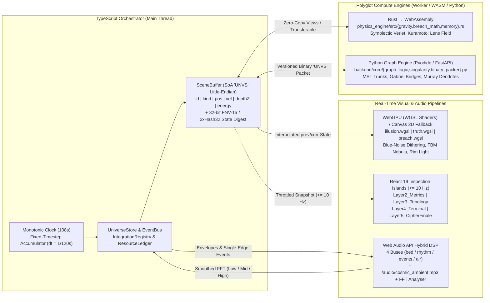

# 🌌 UNIVERSE // НЕЙРОВЕРС — Interactive Polyglot Audiovisual Installation (v2.0)

[]([https://dubnovalexey.github.io/universe/](https://dubnovalexey.github.io/universe/))
[](#runtime-polyglot-architecture--data-flow)
[](#truth-policy--deployment-modes)

<p align="center">
  <a href="#-english-documentation"><strong>🇬🇧 ENGLISH DOCUMENTATION</strong></a>
  &nbsp;&nbsp;·&nbsp;&nbsp;
  <a href="#-русская-документация"><strong>🇷🇺 РУССКАЯ ДОКУМЕНТАЦИЯ</strong></a>
  &nbsp;&nbsp;·&nbsp;&nbsp;
  <a href="[https://dubnovalexey.github.io/universe/](https://dubnovalexey.github.io/universe/)"><strong>▶ LIVE INSTALLATION</strong></a>
</p>

---

# 🇬🇧 ENGLISH DOCUMENTATION

## Overview

**UNIVERSE (Neuroverse)** is a full-screen, real-time interactive audiovisual installation ("From Zero to Zero", ~108-second continuous cycle) and a live **Runtime Polyglot** engineering showcase hosted on GitHub Pages.

**Core Philosophical Axis:** Cosmic beauty (`ILLUSION`), emergent neural topology (`NEXUS`), and computational logic (`X-RAY / TRUTH`) are not separate animations — they are **three optical readings of a single authoritative simulation state (`SceneBuffer`)**.

- **For Viewers, Art Directors & Technical Recruiters:** A self-starting, museum-grade generative film driven by light, deep velvet shadows, multi-echelon parallax (`Z0`–`Z3`), and spatial sound — compelling even with all UI and text hidden.
- **For Senior Engineers, Graphics Programmers & CTOs:** A transparent polyglot system where **TypeScript, Rust (WebAssembly), WebGPU (WGSL), Python (Pyodide / FastAPI), React 19, and Web Audio API** operate on a shared Structure-of-Arrays (`SoA`) memory contract. Every telemetry metric in `X-RAY` mode is measured in real time and tagged with its exact computing module (`[rust/gravity.rs]`, `[python/graph_logic.py]`, `[wgsl/breach.wgsl]`, `[web-audio]`).

---

## The 5 Phases of the 108-Second Cycle

| Phase | Timeline | Visual & Dramatic Arc (`ILLUSION` / `NEXUS`) | Mathematical Model & Compute Core (`TRUTH / X-RAY`) |
| :--- | :---: | :--- | :--- |
| **01. VOID** *(Quantum Cradle)* | `0 – 17s` | Pearl-amber Zero Point breathing in deep obsidian vacuum (`#020308`) with tilted 3D gravitational ripples across 4 depth echelons (`Z0`–`Z3`). | Binary inspiral gravitational chirp law `T_n = T_0 · (1 − n/N)^α`, smoothed FFT spectral envelopes, and deterministic `BirthRecord[]` initialization with circular velocity `v_t ≈ sqrt(G·M(r)/r)`. |
| **02. GENESIS** *(N-Body Galaxy)* | `17 – 39s` | Tilted 4-arm spiral galaxy across the 16:9 viewport, binary barycenters connected by a tidal light bridge, volumetric FBM/Curl gas folds, dark light-absorbing dust canyons, and cold cyan rim lighting (`#7DD3FC`). | 3-Tier **Velocity Verlet** symplectic integrator in `Rust/WASM` (`gravity.rs`) tracking real energy drift `ΔE/E₀`, 5–6 octave domain-warped FBM, RK2 curl-noise streamlines, and **Kuramoto phase synchronization** `r(t) ∈ [0,1]`. |
| **03. NEXUS** *(The Cosmic Brain)* | `39 – 61s` | Seamless `C¹`-continuous deformation of spiral arms into two sculpted cortical hemispheres around a 5-ring Keplerian skeleton. Tri-layered neuron somas, branching dendrites, and synaptic pulse comets with `afterglow` and `#F59E0B` soma interference flashes. | Graph topology generated by `Python / Worker` (`graph_logic.py`): **Class A Axon Trunks** via MST/centrality hubs, **Class B Bridges** via Gabriel graph, **Class C Dendrites** via Murray's law `r_p³ = Σ r_c³`, and discrete-event pulse routing along arc-length LUTs. |
| **04. TENSION / BREACH** *(Optical Rift & X-RAY)* | `61 – 79s` | Three sequential gravitational anomalies deform the neural pathways. An inertial `BREACH LENS` follows pointer/touch/keyboard input, refracting stars along its rim, spawning branching microcracks, and exposing the internal engineering blueprint. | `C¹`-continuous radial/tangential refraction field `δ(p) = r̂·A·g(d) + t̂·B·g(d)` (`breach.wgsl` / `breach_math.rs`), deterministic microcrack generator, logarithmic velocity vectors, and non-overlapping screen-space optical callouts. |
| **05. SINGULARITY → LOGIC → ODOMETER** | `79 – 108s` | Relativistic accretion disk with Doppler beaming & gravitational lensing → synchronous alignment of all 3 worlds in `LOGIC` → spiral collapse into Zero → **2.5s of living silence** → 3D **Odometer** glyph reels locking into the project manifesto and holographic GitHub card. | Ray deflection profile `α ≈ 4GM/(c²b)`, verified `stateDigest(ILLUSION) == stateDigest(X-RAY) == stateDigest(NEXUS)`, `AnalyserNode RMS < -80 dBFS` silence verification, magnetic detent 3D reels, and leak-free `ResourceLedger` reset on `Restart`. |

---

## Runtime Polyglot Architecture & Data Flow



### Language & Module Responsibilities

| Technology | Engineering Role | Repository Files |
| :--- | :--- | :--- |
| **TypeScript / Astro** | Monotonic clock (`0..108s`), fixed-timestep physics accumulator, `SceneBuffer` (`SoA`), `IntegrationRegistry`, `ResourceLedger`, adaptive `QualityGovernor`, and 3D Odometer reel engine. | `frontend/src/core/*`, `frontend/src/store/*`, `frontend/src/bridge/cipherOdometerEngine.ts`, `frontend/src/pages/index.astro` |
| **Rust → WebAssembly** | Deterministic numerical kernel: 3-tier N-body gravity (`Velocity Verlet` with measured energy drift `ΔE/E₀`), Kuramoto synchronization, optical lens refraction math, and `State Digest`. | `physics_engine/src/lib.rs`, `physics_engine/src/gravity.rs`, `physics_engine/src/breach_math.rs`, `physics_engine/src/memory.rs` |
| **WebGPU / WGSL + Canvas 2D** | Volumetric anisotropic nebulae (`FBM`, `domain warping`), light-absorbing dust canyons, blue-noise dithering against dark gradient banding, `BREACH LENS` post-processing, and full Canvas 2D fallback. | `frontend/src/engine/webgpu/{illusion,truth,breach}.wgsl`, `frontend/src/engine/pipeline.ts`, `frontend/src/engine/renderer.ts` |
| **Python 3 (Pyodide / FastAPI)** | `NEXUS` cortical graph topology (MST axon trunks, Gabriel bridges, Murray's law dendrites), graph metrics (clustering, diameter), and little-endian binary frame packing. | `backend/main.py`, `backend/core/graph_logic.py`, `backend/core/stress_solver.py`, `backend/core/singularity.py`, `backend/utils/binary_packer.py` |
| **React 19 (`.tsx`)** | Low-frequency (`<= 10 Hz`) engineering inspection overlays, spatial entity picking across all three optical views, and accessible semantic DOM controls for the final GitHub card. | `frontend/src/layers/Layer2_Metrics.tsx`, `Layer3_Topology.tsx`, `Layer4_Terminal.tsx`, `Layer5_CipherFinale.tsx` |
| **Web Audio API + MP3** | 4-bus procedural synthesizer (`bed`, `rhythm`, `events`, `air` with spatial 3D panning and synthetic convolution reverb) blended with `/audio/cosmic_ambient.mp3` and smoothed FFT extraction. | `frontend/src/utils/audioSync.ts`, `frontend/public/audio/cosmic_ambient.mp3` |

---

## Truth Policy & Deployment Modes

This project strictly enforces **Zero Fake Telemetry**. Every status badge in the UI is driven by `IntegrationRegistry` and reflects actual runtime execution:

| Deployment Mode | Active Compute Path | Authentic UI Status Badges |
| :--- | :--- | :--- |
| **A. Static GitHub Pages (Default)** | Runs 100% client-side without external servers: physics via `Rust/WASM` (or verified TS reference fallback), `NEXUS` graph via local `Web Worker`. | `WASM READY` (or `TS FALLBACK`), `WEBGPU ACTIVE` (or `CANVAS2D FALLBACK`), `LOCAL WORKER`, `CLIENT-ONLY` |
| **B. Static + Pyodide (In-Browser Python)** | Lazy-loads Python runtime inside a dedicated Worker after the first rendered frame to execute `graph_logic.py` directly in the browser. | `PYODIDE LOADING → PYODIDE READY` (or `PYTHON: TS FALLBACK` on low-memory mobile profiles) |
| **C. Static + FastAPI Server (Optional)** | Connects via binary WebSocket to a running FastAPI backend; displays `SERVER CONNECTED` strictly after a verified `hello` handshake (`schemaVersion` + `heartbeat`). | `SERVER CONNECTED`, `[python/graph_logic.py]`, `[rust/gravity.rs]` |

---

## Controls & 30-Second "Engineer's Tour"

1. **Open the `BREACH LENS`:** Press and hold the left mouse button (or touch-and-hold on mobile / press `Space` and move with `Arrow Keys`). Observe star refraction along the rim, branching microcracks, and the internal `X-RAY` blueprint in identical world coordinates.
2. **Verify Polyglot Ownership:** Hover the lens over any active node — its optical callout displays its stable `id`, position, velocity vector, `State Digest`, and the exact module that computed it (`[rust/gravity.rs]`, `[python/graph_logic.py]`, `[wgsl/breach.wgsl]`).
3. **Switch Inspection Modes:** Use the bottom dock (or keys `1`–`5`) to toggle between `COSMOS` (pure film), `METRICS` (live frame time, `ΔE/E₀`, Kuramoto `r(t)`), `TOPOLOGY` (graph classes & pulse queue), `TERMINAL` (event bus & silence RMS check), and full-screen `X-RAY`.
4. **URL Parameters for Reproducible Testing:**
    - `?seed=104729` — run a deterministic, reproducible universe with a specific PRNG seed;
    - `?quality=high|medium|low` — override the automatic frame-time quality governor;
    - `?debug=1` — start with engineering telemetry and `State Digest` verification visible;
    - `?kiosk=1` — exhibition mode (automatically triggers `Restart Universe` 12 seconds after the final card locks).

---

## Quick Start & Local Development

```bash
# 1. Clone repository & install workspace dependencies
git clone https://github.com/DubnovAlexey/universe.git
cd universe
npm install

# 2. Start the frontend development server (http://localhost:4321)
npm run dev:frontend

# 3. (Optional) Compile the Rust → WebAssembly physics kernel
npm run build:wasm

# 4. (Optional) Launch the Python FastAPI WebSocket server
cd backend
pip install -r requirements.txt
uvicorn main:app --reload --port 8000

# 5. Run production build
npm run build --workspace=frontend
```

---
---

# 🇷🇺 РУССКАЯ ДОКУМЕНТАЦИЯ

## О проекте

**UNIVERSE (Нейроверс)** — полноэкранная интерактивная кинематографическая аудиовизуальная инсталляция («Из Нуля в Ноль», непрерывный цикл ≈ 108 секунд) и живая демонстрация полиглотной архитектуры **Runtime Polyglot** на GitHub Pages.

**Философская ось:** Космическая красота (`ILLUSION`), возникающая нейронная сеть мозга (`NEXUS`) и вычислительная логика (`X-RAY / TRUTH`) — это не три разные анимации, а **три оптических прочтения одного и того же буфера состояния симуляции (`SceneBuffer`)**.

- **Для зрителя, арт-директора и HR:** самодостаточный генеративный научно-фантастический фильм, который запускается автоматически с первой секунды и удерживает внимание драматургией света, глубокими бархатными тенями, 4 планами параллакса (`Z0`–`Z3`) и пространственным звуком — даже при полном отключении текста и интерфейса.
- **Для Senior-разработчика, системного программиста и CTO:** открытая многоязыковая система, в которой **TypeScript, Rust (WebAssembly), WebGPU (WGSL), Python (Pyodide / FastAPI), React 19 и Web Audio API** синхронно работают над единым бинарным контрактом памяти (`Structure of Arrays`). Каждое число в режиме рентгена (`X-RAY`) измеряется фактически и имеет точную подпись вычислившего его модуля (`[rust/gravity.rs]`, `[python/graph_logic.py]`, `[wgsl/breach.wgsl]`, `[web-audio]`).

---

## Пять фаз единого 108-секундного цикла

| Фаза цикла | Тайминг | Визуальная драматургия (`ILLUSION` / `NEXUS`) | Математическая модель и вычислительное ядро (`TRUTH / X-RAY`) |
| :--- | :---: | :--- | :--- |
| **01. VOID** *(Квантовая колыбель)* | `0 – 17 с` | Жемчужно-золотистая Точка Нуля дышит в обсидиановом вакууме (`#020308`), распуская наклонные 3D-фронты гравитационной ряби на 4 эшелонах глубины (`Z0`–`Z3`). | Закон гравитационного чирпа двойной системы `T_n = T_0 · (1 − n/N)^α`, сглаженные огибающие FFT-спектра и детерминированная генерация `BirthRecord[]` с круговой скоростью `v_t ≈ sqrt(G·M(r)/r)`. |
| **02. GENESIS** *(Галактика N-тел)* | `17 – 39 с` | Наклонный 3D-диск четырёхрукавной спиральной галактики во весь экран 16:9, два вращающихся центра масс с приливным световым мостом, газовые складки, тёмные пылевые каньоны поглощения света и холодный контровой свет `rim light` (`#7DD3FC`). | Трёхъярусный симплектический интегратор **Velocity Verlet** в `Rust/WASM` (`gravity.rs`) с выводом реального дрейфа энергии `ΔE/E₀`, 5–6 октав FBM с `domain warping`, волокна `RK2 curl-noise` и волна фазовой синхронизации **Курамото** `r(t) ∈ [0,1]`. |
| **03. NEXUS** *(Головной Мозг Вселенной)* | `39 – 61 с` | Бесшовная `C¹`-деформация рукавов галактики в два объёмных полушария Головного Мозга с бороздами извилин вокруг каркаса из 5 встречных кеплеровских колец. Трёхчастные сомы нейронов, дендриты и кометы импульсов с `afterglow` и янтарной интерференцией `#F59E0B`. | Построение графа в `Python / Worker` (`graph_logic.py`): **Класс A (Магистрали)** по остову MST и хабам центральности, **Класс B (Мосты)** по графу Габриэля, **Класс C (Дендриты)** по закону Мюррея `r_p³ = Σ r_c³`, движение импульсов по таблице длины дуги (`lengthLUT`). |
| **04. TENSION / BREACH** *(Оптический разрыв и X-RAY)* | `61 – 79 с` | Три последовательные гравитационные аномалии упруго изгибают нейронные тракты. Инерционная линза `BREACH LENS` следует за мышью, касанием или клавиатурой, преломляя звёзды на кромке, пуская микротрещины и открывая внутренний чертёж. | `C¹`-непрерывное поле преломления `δ(p) = r̂·A·g(d) + t̂·B·g(d)` (`breach.wgsl` / `breach_math.rs`), детерминированные ветвящиеся микротрещины, логарифмические векторы скорости и неперекрывающиеся оптические выноски (`callouts`). |
| **05. SINGULARITY → LOGIC → ODOMETER** | `79 – 108 с` | Многослойный аккреционный диск с допплеровским усилением и гравитационным линзированием → слияние 3 миров в `LOGIC` → спиральное схлопывание в Ноль → **2,5 с живой тишины** → 3D-барабаны **Odometer** и голографическая карточка `DubnovAlexey / universe`. | Отклонение лучей `α ≈ 4GM/(c²b)`, равенство `stateDigest(ILLUSION) == stateDigest(X-RAY) == stateDigest(NEXUS)`, контроль тишины `AnalyserNode RMS < -80 dBFS`, магнитная фиксация барабанов (`detent`) и очистка `ResourceLedger` при `Restart`. |

---

## Роли языков и модулей в репозитории

| Язык / Технология | Инженерная роль в системе | Файлы в репозитории |
| :--- | :--- | :--- |
| **TypeScript / Astro** | Монотонный clock (`0..108 с`), аккумулятор фиксированного шага физики, буфер `SceneBuffer` (`SoA`), реестр `IntegrationRegistry`, учёт ресурсов `ResourceLedger`, `QualityGovernor` и движок 3D-одометра. | `frontend/src/core/*`, `frontend/src/store/*`, `frontend/src/bridge/cipherOdometerEngine.ts`, `frontend/src/pages/index.astro` |
| **Rust → WebAssembly** | Детерминированное числовое ядро: гравитация N-тел (`Velocity Verlet`, расчёт дрейфа энергии `ΔE/E₀`), синхронизация Курамото, математика линзы преломления и хеш состояния `State Digest`. | `physics_engine/src/lib.rs`, `physics_engine/src/gravity.rs`, `physics_engine/src/breach_math.rs`, `physics_engine/src/memory.rs` |
| **WebGPU / WGSL + Canvas 2D** | Объёмные анизотропные туманности (`FBM`, `domain warping`), тёмные пылевые каньоны поглощения, дизеринг синим шумом (`blue-noise`) против ступенчатости тёмных градиентов, рефракция линзы и резервный путь на High-DPI Canvas 2D. | `frontend/src/engine/webgpu/{illusion,truth,breach}.wgsl`, `frontend/src/engine/pipeline.ts`, `frontend/src/engine/renderer.ts` |
| **Python 3 (Pyodide / FastAPI)** | Генерация топологии графа `NEXUS` (магистрали MST, мосты Габриэля, дендриты по закону Мюррея), метрики графа и бинарная упаковка пакетов `little-endian`. | `backend/main.py`, `backend/core/graph_logic.py`, `backend/core/stress_solver.py`, `backend/core/singularity.py`, `backend/utils/binary_packer.py` |
| **React 19 (`.tsx`)** | Панели инженерной инспекции (подписка на срез состояния `<= 10 Гц` без нагрузки на рендер-цикл), выбор узла во всех трёх оптиках и доступный семантический DOM-слой финальной карточки GitHub. | `frontend/src/layers/Layer2_Metrics.tsx`, `Layer3_Topology.tsx`, `Layer4_Terminal.tsx`, `Layer5_CipherFinale.tsx` |
| **Web Audio API + MP3** | 4-шинная процедурная генерация звука (`bed`, `rhythm`, `events`, `air` с пространственным панорамированием и синтетическим ревербератором) в гибридной связке с `/audio/cosmic_ambient.mp3` и FFT-анализатором. | `frontend/src/utils/audioSync.ts`, `frontend/public/audio/cosmic_ambient.mp3` |

---

## Честная матрица режимов исполнения (Truth Policy)

Интерфейс никогда не показывает фальшивых цифр или выдуманных подключений. Все статусы считываются из `IntegrationRegistry`:

| Режим работы | Как выполняются вычисления | Честные статусы в интерфейсе (`METRICS / TERMINAL`) |
| :--- | :--- | :--- |
| **A. Static GitHub Pages (Обязательный)** | Полностью автономная работа в браузере без внешнего сервера: физика в `Rust/WASM` (или эталонном TS-ядре), граф `NEXUS` — в локальном `Web Worker`. | `WASM READY` (или `TS FALLBACK`), `WEBGPU ACTIVE` (или `CANVAS2D FALLBACK`), `LOCAL WORKER`, `CLIENT-ONLY` |
| **B. Static + Pyodide (Python в браузере)** | Ленивая загрузка интерпретатора Python в Worker после отрисовки первого кадра для исполнения `graph_logic.py` прямо на клиенте. | `PYODIDE LOADING → PYODIDE READY` (или `PYTHON: TS FALLBACK` на мобильном профиле `low`) |
| **C. Static + FastAPI Server (Опциональный)** | Подключение по бинарному WebSocket к серверу FastAPI; статус `SERVER CONNECTED` активируется строго после подтверждённого рукопожатия (`hello` со `schemaVersion` и `heartbeat`). | `SERVER CONNECTED`, `[python/graph_logic.py]`, `[rust/gravity.rs]` |

---

## Управление и 30-секундный «Тур инженера»

1. **Раскрыть оптическую линзу `BREACH LENS`:** зажмите левую кнопку мыши в любой точке космоса (или удерживайте касание на смартфоне / клавишу `Space`, перемещая линзу стрелками клавиатуры) — вы увидите преломление звёзд на границе, микротрещины и внутренний чертёж `X-RAY` в тех же мировых координатах.
2. **Проверить язык-владелец вычислений:** наведите линзу на активный узел — в оптической выноске (`callout`) отобразятся его стабильный `id`, координаты, скорость, `State Digest` и модуль-источник (`[rust/gravity.rs]`, `[python/graph_logic.py]`, `[wgsl/breach.wgsl]`).
3. **Переключить режимы инспекции:** используйте нижнюю панель (или клавиши `1`–`5`) для переключения между режимами `COSMOS`, `METRICS`, `TOPOLOGY`, `TERMINAL` и `X-RAY`.
4. **URL-параметры для воспроизводимых проверок:**
    - `?seed=104729` — запуск детерминированной Вселенной с фиксированным `seed`;
    - `?quality=high|medium|low` — принудительный выбор ступени качества;
    - `?debug=1` — отображение инженерной телеметрии и `State Digest` со старта;
    - `?kiosk=1` — выставочный режим с автоматическим перезапуском цикла через 12 секунд после сборки финальной карточки.

---

## Звуковая архитектура и Авторство

- **Гибридный аудио-движок:** процедурный Web Audio синтезатор реального времени (`frontend/src/utils/audioSync.ts`) + эмбиент-композиция `frontend/public/audio/cosmic_ambient.mp3` (с поддержкой ротации плейлиста треков).
- **Автор и архитектор проекта:** **Alexey Dubnov** (`DubnovAlexey`) — [https://github.com/DubnovAlexey/universe](https://github.com/DubnovAlexey/universe)