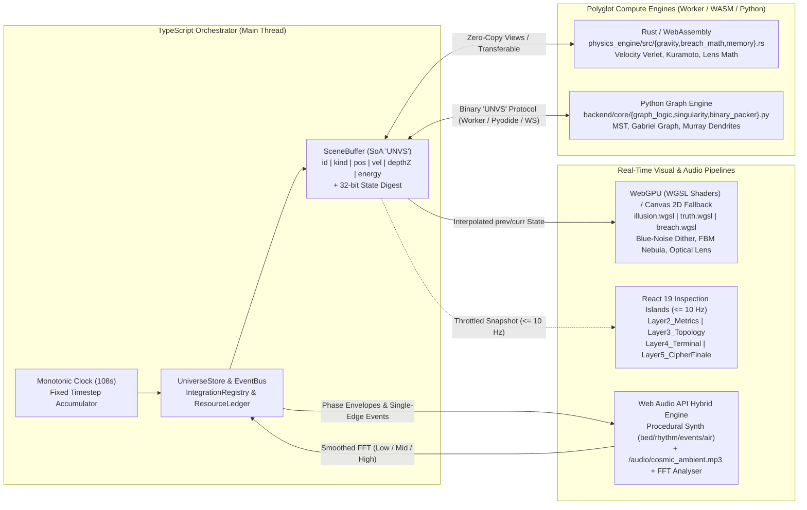

# 🌌 UNIVERSE // НЕЙРОВЕРС — Interactive Polyglot Audiovisual Installation

[]([https://dubnovalexey.github.io/universe/](https://dubnovalexey.github.io/universe/))
[](#архитектура-и-поток-данных-runtime-polyglot)
[](#четыре-уровня-проверки-для-инженеров)

> **Полноэкранная кинематографическая аудиовизуальная инсталляция «Из Нуля в Ноль» (108 секунд) и живая демонстрация полиглотной Full-Stack & Systems архитектуры в едином адресном пространстве.**  
> **[▶ ОТКРЫТЬ ИНТЕРАКТИВНУЮ ИНСТАЛЛЯЦИЮ (LIVE DEMO)](https://dubnovalexey.github.io/universe/)**

---

## О проекте (В двух словах)

**UNIVERSE (Нейроверс)** — это интерактивный научно-фантастический фильм реального времени и вычислительная лаборатория, где **космическая красота и программная логика работают как две оптики одного и того же состояния симуляции**:
- **Для зрителя, HR и арт-директора:** непрерывное 108-секундное путешествие сквозь 5 бесшовно перетекающих миров — от дыхания Точки Нуля и гравитационной спиральной галактики до пробуждения двухполушарной нейронной сети Головного Мозга Вселенной (`NEXUS`), оптического преломления реальности (`BREACH LENS`), 2,5 секунд абсолютной тишины и сборки финального манифеста на 3D-барабанах одометра.
- **Для Senior-разработчика, CTO и системного инженера:** открытая инженерная система, в которой **TypeScript, Rust (WebAssembly), WebGPU (WGSL), Python (FastAPI / Pyodide), React 19 и Web Audio API** синхронно работают над единым бинарным буфером состояния (`SceneBuffer`, Structure of Arrays), а каждое число в режиме рентгена (`X-RAY`) сопровождается точной меткой вычислившего его языка и модуля.

---

## Пять фаз единого 108-секундного цикла

| Фаза цикла | Тайминг | Художественный образ (`ILLUSION` / `NEXUS`) | Вычислительное ядро и математическая модель (`TRUTH / X-RAY`) |
| :--- | :---: | :--- | :--- |
| **01. VOID** *(Квантовая колыбель)* | `0 – 17 с` | Жемчужно-золотистая Точка Нуля в обсидиановом вакууме `#020308` и наклонные 3D-фронты ряби на 4 эшелонах глубины (`Z0`–`Z3`). | Закон гравитационного чирпа двойной системы $T_n = T_0(1 - n/N)^\alpha$, сглаженный FFT-анализ спектра и генерация `BirthRecord[]` с круговой скоростью $v_t \approx \sqrt{GM(r)/r}$. |
| **02. GENESIS** *(Галактика N-тел)* | `17 – 39 с` | Четырёхрукавная спиральная галактика во весь экран 16:9, два вращающихся барицентра со световым мостом, газовые складки, тёмные пылевые каньоны поглощения и контровой свет `rim light` `#7DD3FC`. | Симплектический интегратор **Velocity Verlet** в `Rust/WASM` (`gravity.rs`, контроль дрейфа энергии $\Delta E/E_0$), `FBM/Curl Noise` и волна фазовой синхронизации **Курамото** $r(t) \in [0,1]$. |
| **03. NEXUS** *(Головной Мозг Вселенной)* | `39 – 61 с` | Бесшовная деформация рукавов галактики в два объёмных полушария Головного Мозга вокруг каркаса из 5 кеплеровских колец. Сомы нейронов, дендриты и яркие кометы синаптических импульсов с послесвечением `afterglow` и янтарной интерференцией `#F59E0B`. | Построение 3 классов кривых в `Python / Worker` (`graph_logic.py`): магистрали по **MST**, мосты по **графу Габриэля**, дендриты по **закону Мюррея** $r_p^3 = \sum r_c^3$, движение сигналов по таблице длины дуги (`lengthLUT`). |
| **04. TENSION / BREACH** *(Оптический разрыв и X-RAY)* | `61 – 79 с` | Три последовательные гравитационные аномалии упруго натягивают нити мозга. Инерционная линза `BREACH LENS` преломляет звёзды на кромке, пускает ветвящиеся микротрещины и вскрывает инженерный чертёж. | Поле рефракции $\delta(p) = \hat{r} A g(d) + \hat{t} B g(d)$ (`breach.wgsl` / `breach_math.rs`), логарифмические векторы скоростей и неперекрывающиеся выноски (`callouts`) с тегом языка-владельца. |
| **05. SINGULARITY → LOGIC → ODOMETER** | `79 – 108 с` | Многослойный аккреционный диск с эффектом Допплера и гравитационным линзированием → слияние 3 миров в `LOGIC` → спиральное схлопывание → **2,5 с живой тишины** → 3D-барабаны `Odometer` и голографическая карточка `DubnovAlexey / universe`. | Релятивистское отклонение $\alpha \approx 4GM/(c^2b)$, проверка равенства `State Digest` трёх оптик, контроль тишины `RMS < -80 dBFS`, магнитная фиксация барабанов (`detent`) и полный возврат ресурсов по `ResourceLedger` при `Restart`. |

---

## Архитектура и поток данных (Runtime Polyglot)



### Роли языков и модулей в репозитории

| Язык / Технология | Инженерная задача в проекте | Ключевые файлы репозитория |
| :--- | :--- | :--- |
| **TypeScript / Astro** | Монотонный clock (`0..108 с`), аккумулятор фиксированного шага физики, `SceneBuffer` (SoA), `IntegrationRegistry`, `ResourceLedger`, `QualityGovernor` и 3D-одометр финала. | `frontend/src/core/*`, `frontend/src/store/*`, `frontend/src/bridge/cipherOdometerEngine.ts`, `frontend/src/pages/index.astro` |
| **Rust → WebAssembly** | Детерминированное числовое ядро: иерархическая гравитация N-тел (`Tier A/B/C`, Velocity Verlet с контролем $\Delta E/E_0$), синхронизация Курамото, математика преломления линзы и расчёт `State Digest`. | `physics_engine/src/lib.rs`, `physics_engine/src/gravity.rs`, `physics_engine/src/breach_math.rs`, `physics_engine/src/memory.rs` |
| **WebGPU / WGSL + Canvas 2D** | Процедурные анизотропные туманности (`FBM`, `domain warping`), тёмные пылевые каньоны поглощения, дизеринг синим шумом против бандинга, рефракция кромки `BREACH LENS` и совместимый резервный рендер на High-DPI Canvas 2D. | `frontend/src/engine/webgpu/{illusion,truth,breach}.wgsl`, `frontend/src/engine/pipeline.ts`, `frontend/src/engine/renderer.ts` |
| **Python 3 (FastAPI / Pyodide)** | Построение топологии Головного Мозга `NEXUS` (MST-магистрали, мосты Габриэля, дендриты по закону Мюррея), расчёт метрик графа и бинарная упаковка пакетов `little-endian`. | `backend/main.py`, `backend/core/graph_logic.py`, `backend/core/stress_solver.py`, `backend/core/singularity.py`, `backend/utils/binary_packer.py` |
| **React 19 (`.tsx`)** | Низкочастотные (`<= 10 Гц`) панели инженерной инспекции, выбор узла с подсветкой во всех трёх оптиках и доступный семантический DOM-слой финальной карточки GitHub. | `frontend/src/layers/Layer2_Metrics.tsx`, `Layer3_Topology.tsx`, `Layer4_Terminal.tsx`, `Layer5_CipherFinale.tsx` |
| **Web Audio API + MP3** | Многошинная процедурная генерация звука (`bed`, `rhythm`, `events`, `air` с пространственным `PannerNode` и `ConvolverNode`) в гибридной связке с `/audio/cosmic_ambient.mp3` и сглаженным FFT-анализатором. | `frontend/src/utils/audioSync.ts`, `frontend/public/audio/cosmic_ambient.mp3` |

---

## Честная матрица режимов исполнения (Truth Policy)

Интерфейс проекта никогда не имитирует неподключённые технологии и всегда показывает фактический источник данных из `IntegrationRegistry`:

| Режим запуска | Как работает физика и граф | Фактические статусы в UI (`METRICS / TERMINAL`) |
| :--- | :--- | :--- |
| **1. GitHub Pages (Static Autonomous)** | Вся сцена работает автономно в браузере без внешнего сервера: физика считается в `Rust/WASM` (или эталонном TS при отсутствии `.wasm`), граф `NEXUS` — в локальном `Worker` / `Pyodide`. | `WASM READY` (или `TS FALLBACK`), `WEBGPU ACTIVE` (или `CANVAS2D FALLBACK`), `LOCAL WORKER`, `CLIENT-ONLY` |
| **2. Local Full-Stack (`npm run dev` + FastAPI)** | При запущенном локальном сервере Python фронтенд проходит рукопожатие `hello` (`schemaVersion` + `heartbeat`) и получает бинарные пакеты графа по WebSocket. | `SERVER CONNECTED`, `[python/graph_logic.py]`, `[rust/gravity.rs]` |

---

## Управление и 30-секундный «Тур инженера»

1. **Раскрыть оптическую линзу `BREACH LENS`:** зажмите левую кнопку мыши (или удерживайте касание пальцем на экране / клавишу `Space`, перемещая линзу стрелками клавиатуры) — вы увидите физическое преломление звёзд на кромке, микротрещины и внутренний чертёж `X-RAY` в тех же мировых координатах.
2. **Проверить владельца вычислений:** наведите линзу на любой активный узел — в оптической выноске (`callout`) отобразятся его стабильный `id`, координаты, вектор скорости, `State Digest` и точный модуль-источник (`[rust/gravity.rs]`, `[python/graph_logic.py]`, `[wgsl/breach.wgsl]`).
3. **Переключить уровни инспекции:** используйте нижнюю панель (или клавиши `1`–`5`) для переключения между чистым кино-режимом (`COSMOS`), живой телеметрией (`METRICS`), структурой графа (`TOPOLOGY`), журналом шины событий (`TERMINAL`) и глобальным рентгеном (`X-RAY`).
4. **Параметры URL для отладки и тестирования:**
    - `?seed=42` — запуск воспроизводимой детерминированной Вселенной с заданным `seed`;
    - `?quality=high|medium|low` — принудительный выбор профиля графики;
    - `?debug=1` — открытие панели расширенной диагностики и `State Digest` со старта;
    - `?kiosk=1` — выставочный режим с автоматическим перезапуском цикла через 12 секунд после сборки финальной карточки.

---

## Быстрый старт и локальная сборка

```bash
# 1. Клонирование репозитория и установка зависимостей
git clone https://github.com/DubnovAlexey/universe.git
cd universe
npm install

# 2. Запуск клиентской инсталляции в режиме разработки (http://localhost:4321)
npm run dev:frontend

# 3. (Опционально) Сборка Rust/WASM физического ядра
npm run build:wasm

# 4. (Опционально) Запуск Python/FastAPI сервера для режима SERVER CONNECTED
cd backend
pip install -r requirements.txt
uvicorn main:app --reload --port 8000

# 5. Производственная сборка фронтенда
npm run build --workspace=frontend
```

---

## Аудио и Лицензия

- **Звуковое сопровождение:** процедурный Web Audio синтезатор реального времени (`frontend/src/utils/audioSync.ts`) + эмбиент-трек `frontend/public/audio/cosmic_ambient.mp3` (с поддержкой расширения плейлиста).
- **Автор и архитектор проекта:** **Alexey Dubnov** — [github.com/DubnovAlexey/universe](https://github.com/DubnovAlexey/universe)