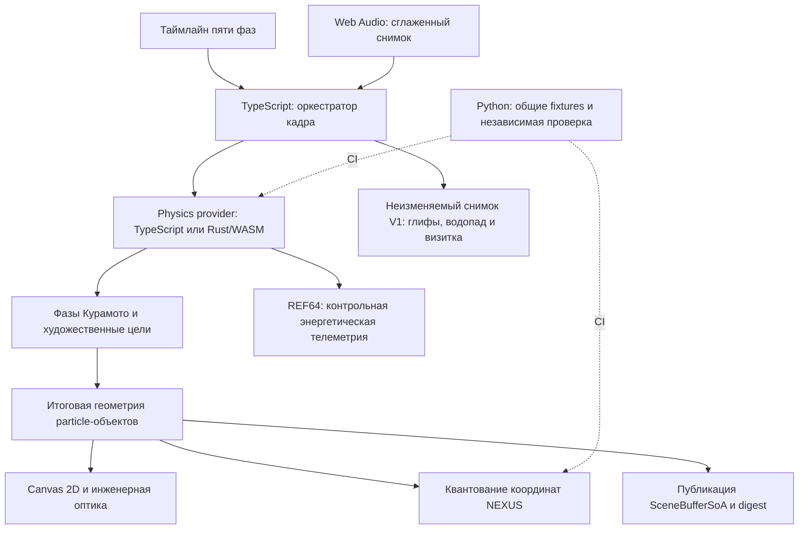

# ADR-001 — работающие технологии и единое состояние UNIVERSE

Дата: 25 октября 2026 года. Исходная версия: `v2.5.0`, commit `c2e2c0c`.

Статус: фундамент Rust/WASM реализован и проверен автоматическими сценариями; выборочный просмотр production-сборки подтвердил `WASM_ACTIVE`/`READY`. Полное браузерное покрытие остаётся открытым. Исторический аудит и исходные проверки относятся к `c2e2c0c`. V1 (общий снимок, Unicode-грамматика и Roll/Dwell) реализован в исходниках и проверен модулями; исторический pipeline и smoke 24.10 отделены от успешного production-прогона изменений 25.10 и выборочного desktop/mobile smoke; результаты отмечены в `QA_STATUS.md`. Глубина V2, переходы V3, Worker и WebGPU остаются планом; крупное разделение renderer/CSS выделено в отдельный последний этап.

## 1. Задача решения

UNIVERSE должен убедительно соединять визуальное путешествие и вычислительные компоненты. Технология считается действующей частью браузерной сцены, когда её результат используется потребителем и это можно проверить. Присутствие исходника, успешный импорт или обнаружение адаптера отдельно такого утверждения не подтверждают.

Для статической презентации на GitHub Pages роли распределяются по назначению: Astro собирает страницу, TypeScript управляет сценой, Canvas 2D рисует композицию, Web Audio анализирует трек, Rust/WASM рассчитывает фазы Курамото и контрольные орбиты, Python независимо проверяет численные контракты. WebGPU/WGSL пока представлен probe/спецификациями; отдельного Worker нет. Постоянный Python-сервер для основной демонстрации не требуется.

Принятый порядок реализации: контракты времени и единого состояния → рабочий Rust/WASM → символы, глубина и переходы → Worker по измерениям → WebGPU. Визуальные улучшения должны читать закреплённые контракты, чтобы подключение вычислительного provider не потребовало их переделки.

## 2. Фактическое состояние исходной версии `c2e2c0c`

| Компонент | Что подтверждено исходниками | Что ещё не реализовано |
|---|---|---|
| Astro + TypeScript | Сборка статической страницы, store пяти фаз, цикл кадров, DOM-интерфейс | Сквозной тест всей пользовательской презентации |
| Canvas 2D | Основной активный рендер всех пяти фаз, графа и инженерной оптики | Общий гарантированный контракт чтения финальных координат всеми потребителями |
| Web Audio / HTML audio | Трек, запуск после жеста, аудиоснимок и сглаженные огибающие | Полная проверка на устройствах и прослушивание границы повторения трека |
| Rust/WASM | C ABI, Rust-математика и 5 нативных тестов; загрузчик валидирует WASM | Файл `frontend/public/wasm/physics_engine.wasm` пуст; CI его не собирает; связь с видимыми координатами не завершена |
| WGSL/WebGPU | Три shader-исходника, проверка наличия адаптера | Создание device/pipeline, передача состояния и реальная отправка draw/compute команд |
| NEXUS / `simulationWorker.ts` | Детерминированный графовый движок, реально вызываемый синхронно в браузере | Отдельного Web Worker и протокола сообщений нет |
| Python | HTTP/CLI reference, бинарные пакеты, эталоны и 6 тестов | Не подключён к живой сцене; WebSocket-клиент не совместим с текущим HTTP-сервером по протоколу |

Проверки поддержки и резервные пути имеют самостоятельную ценность, но статусы `READY`, `ACTIVE`, `SIMD` должны описывать реально выполненную работу.

### Основной разрыв: источник видимых координат

Цепочка на исходной версии `c2e2c0c`:

1. `01_void.ts` меняет `QuantumParticle.x/y`, пружинно приближая частицы к художественным целям фаз.
2. Эти данные копируются в `SceneBufferSoA`.
3. Canvas читает particle-объекты; NEXUS строится по их координатам.
4. TS Velocity Verlet отдельно интегрирует 64 контрольные орбиты для физической диагностики.
5. WASM-ветка может изменить `sceneBuffer.pos.x/y`, но это не переносится обратно в видимые particle-объекты и при следующей публикации перезаписывается.

Следствие: добавление непустого WASM-файла само по себе не доказывает влияние Rust на изображение. Одинаковая подпись digest в панелях также не доказывает, что все оптики прочитали одни и те же координаты.

Основные места для воспроизведения аудита: `frontend/src/phases/01_void.ts` (обновление частиц, публикация SoA, построение графа), `frontend/src/engine/renderer.ts` (`getSimParticles`, отрисовка), `frontend/src/bridge/wasmBridge.ts` (контрольный ансамбль и WASM readback).

### Численная семантика требует общего контракта

На исходной версии TS и Rust рассчитывают разные модели: 64 контрольные орбиты вокруг статического центра в TS и ансамбль в поле двух вращающихся центров в Rust. Общие PRNG-векторы не подтверждают паритет траекторий.

Rust использует время `tick * dt`, тогда как основной цикл передаёт переменный шаг. Для меняющегося `dt` это не накопленное время. Кроме того, изменение энергии в движущемся внешнем поле включает работу этого поля и не является само по себе чистой численной ошибкой интегратора.

Существующая `SceneBufferSoA` — набор типизированных массивов и отдельный заголовок; Rust хранит свои массивы. Это полезная схема данных, но не один общий непрерывный блок памяти. Digest — выборочный квантованный диагностический отпечаток, а не доказательство тождества полного состояния или точной физики.

## 3. Реализованный фундамент и развитие контракта

После baseline собран реальный raw Rust/WASM ABI v1 модуль около `54 КиБ`, без imports и JS glue. Он загружается асинхронно по умолчанию; `?wasm=0` принудительно выбирает TS. Оба provider используют общий порядок PRNG и одну модель:

- Фазы Курамото активных частиц управляют дыханием и тройной геометрией позднего GENESIS.
- Отдельные 64 контрольные орбиты `REF64` интегрируются Velocity Verlet в статическом потенциале Пламмера (`GM = 4900`, `ε² = 64`). `ΔE/E₀` — диагностика этих орбит.
- Художественные цели пяти фаз сохранены. Полная N-body динамика всей видимой сцены не реализована.

Текущая цепочка:

Влияние реальной Rust-фазы на итоговые координаты, их графовое квантование и SoA проверено интеграционным сценарием. Общие сигналы V1 публикуются из существующего кадра renderer; независимый RAF, таймеры символов или второй анализатор не создаются.

### Одна публикация состояния

- Provider выполняется до расчёта художественных целей; видимая геометрия затем публикуется в SoA. Скрытой записи Rust в SoA после публикации нет.
- Canvas читает итоговые particle-объекты, граф — квантование тех же координат, SoA — их публикацию. Версия/эпоха для будущего асинхронного Worker ещё входит в план.
- Particle-объекты можно сохранить для художественных целей и метаданных. Они не должны создавать вторую расходящуюся геометрию.
- Новая физика сначала задаёт ограниченный, явно определённый вклад в существующую хореографию. Перевод всей композиции на другую динамическую модель не является условием первого этапа.
- Единое экранное преобразование видимого узла, конца ребра и инженерной выноски — критерий следующего этапа глубины.
- Энергия контрольного консервативного ансамбля подписывается как его диагностика. Она не приписывается всему художественному морфингу.

### Контракт времени и жизненного цикла

- Различать время таймлайна пяти фаз, накопленное время физической симуляции и позицию аудиотрека. Их роли задаются явно; аудио не становится неявными часами physics provider.
- Provider принимает положительный шаг до `0.05 с`, делит его на `ceil(dt / 0.004)` равных подшагов и накапливает реально проинтегрированное время в `f64`. При `dt <= 0` или count `0` время не продвигается. Независимый фиксированный accumulator/догоняющая очередь не вводились; выражение `tick * dt` больше не используется как часы физики.
- Пауза не продвигает время сцены и симуляции; сохранённая политика непрерывности музыки действует отдельно. Возвращение на вкладку не отрабатывает весь пропущенный интервал одним скачком или неограниченной очередью.
- Restart, смена seed/count и переход к фазе получают явную политику сброса/сохранения состояния. Эпоха и номер кадра связывают вход provider, финальную публикацию и потребителей; устаревшие результаты отвергаются.
- Глифы и визуальные огибающие читают общее время сцены и снимок аудиосигналов того же кадра. Для длительности hover используется `frameDtSec = clamp(frameTimeMs/1000,0,0.05)`, равный нулю при pause/hidden; скачок абсолютного `simTimeSec` не меняет elapsed. У потребителей нет собственных независимых часов, повторной интеграции или мутации опубликованной геометрии.

Границы шага, накопление времени и reset/seed/count проверены автоматически. Полный браузерный сценарий паузы, возврата на вкладку и второго цикла остаётся частью проверки релиза. Глифы V1 реализованы на общем снимке; асинхронные эпохи Worker остаются планом.

### Контракт физического provider

ABI v1 передаёт шаг, время и метрики как `f64`; фазы/частоты — `f32[1024]`, позиции/скорости — `f32[3072]` (для физики используются первые 64 орбиты). `step_verlet_nbody` возвращает `1` при успешном шаге/no-op и `0` при отклонении; digest не используется как статус. Host проверяет статус до readback.

Позднее подключение загружает актуальные TS-фазы, частоты, контрольные орбиты, baseline энергии и накопленное время через `commit_uploaded_state` со статусом `1`/`0`. После валидного native-шага обновляются полные TS-зеркала. При trap, ошибке ABI/указателей или неверном результате TS продолжает от последнего принятого состояния; restart/seed/count повторно инициализируют provider. Отклонённый upload требует discard provider со стороны host: экспортированные live-массивы не обеспечивают rollback. Метка активного пути — `WASM_ACTIVE`, без неподтверждённого SIMD. Ускорение Rust не заявляется без измерения.

### Почему Python и Worker нужны в своих ролях

Python уже приносит пользу как независимая реализация контрактов и проверок. Fixture6 и общий transport fixture24 автоматически сравнивают обе реализации; полные 40 рёбер, LUT, радиусы и метрики хранятся в одном JSON. Это усиливает независимую проверку, но не покрывает sampling BFS, лимит 36 хабов или прореживание больших графов. Запуск Pyodide в браузере предлагается только при появлении отдельной полезной функции, оправдывающей интерпретатор и загрузку.

Вынос NEXUS в настоящий Web Worker оправдывается профилированием. Протокол должен включать номер запроса и эпоху seed/restart, ограничивать очередь и отвергать устаревшие ответы. Метрики воркера измеряются отдельно от времени всего кадра.

### Как включать WebGPU

Начать с одного полезного слоя, например глубинной пыли/частиц, получающего данные общего кадра и аудиосигналы. Canvas 2D остаётся рабочим резервом. Поддержка адаптера, создание device и успешная отправка кадра — разные состояния реестра. Потеря device должна возвращать рабочую презентацию.

Существующие WGSL-файлы требуют адаптации к реальному pipeline. В частности, рефракции нужна текстура сцены; один shader-исходник без входного изображения не выполняет преломление Canvas-картинки. Не объявлять все три прохода готовыми после создания первого pipeline.

## 4. План реализации и критерии завершения

| Этап | Результат | Условие завершения |
|---|---|---|
| 0. Исходная база и план | Принятые решения, карта runtime, проверки и выборочный просмотр | Зафиксировано на `c2e2c0c`; полный визуальный/производительный baseline ещё открыт |
| 1. Контракт времени и данных provider | Реализованы общий шаг/накопленное время, перенос состояния и порядок provider → цели → геометрия/граф/SoA | Автоматические проверки времени, reset/seed/count, adoption и влияния native-фазы выполнены; полное браузерное покрытие открыто |
| 2. Рабочий Rust/WASM | Реализованы raw ABI v1, сборка и ограниченный видимый вклад | Фундамент: 13 native Rust и 5 первоначальных WASM-интеграций успешны; текущая шестая BREACH-проверка описана ниже. Production smoke подтвердил `WASM_ACTIVE`/`READY`; общий визуальный/performance review остаётся открытым |
| 3a. V1: общие сигналы и глифы | Реализованы неизменяемый снимок, пять code-point профилей, font fallback, Roll/Dwell и подъём фоновой карточки | Финальный pipeline и выборочный desktop/mobile smoke выполнены; полные браузерные критерии — `QA_STATUS.md` |
| 3b. V2/V3: глубина и переходы | План: экранный transform, слои глубины и преемственность мотивов | Критерии `VISUAL_AUDIO_DIRECTION.md`; одинаковые координаты у оптик и сравнение до/после |
| 4. NEXUS в Worker при подтверждённой пользе | Граф не блокирует главный поток | Ограниченная очередь, отбраковка старых ответов, измеренное улучшение p95 |
| 5. Первый активный WGSL-слой | Заметный полезный WebGPU-проход | Успешные draw/compute, данные того же кадра, корректный Canvas fallback и сравнение стоимости/изображения |
| 6. Проверка релиза и актуализация документов | Воспроизводимая демонстрация для зрителя и инженера | Полный цикл/второй цикл, мобильный показ, аудио, браузерные сценарии и документация по фактам |
| 7. Отдельный завершающий рефакторинг renderer/CSS | Разделение крупных файлов после завершения ранее запланированных этапов | Поведение, композиция и контракты сохранены; актуальные проверки проходят |

Документация и релевантные проверки сопровождают каждый этап, а не откладываются до этапа 6. Этапы 4 и 5 включаются по измерениям и качеству результата. Полезность технологии важнее количества включённых модулей.

Реализация этапов 1–2 подтверждена автоматическими проверками и выборочным production-просмотром. V1 реализован поверх этих контрактов; V2/V3, Worker, WebGPU и завершающее разделение renderer/CSS ещё не реализованы.

## 5. Проверки и честные границы утверждений

### Проверено после подключения Rust/WASM

Текущий набор 25.10 — 61 модульная проверка (39 TS, 9 Python, 13 Rust) и 6 WASM-интеграций; финальный production pipeline под Node 22.23.4 прошёл, свежий audit — 0; выборочный desktop/mobile smoke и границы зафиксированы в `QA_STATUS.md`. Исторический фундамент прошёл 35 модульных + 5 WASM; QA/V1 24.10 — 48 модульных + 5 WASM. Эти результаты не переименовываются в проверку нового состояния. Последняя опубликованная ревизия `b60c995` прошла CI #45 build/deploy; сохраняются текущие Actions v7/v5 и совместимый с Astro `7.4.2` Node `^22.23.4`/engines `>=22.23.4`.

Интеграции реального бинарника проверяют 600 смешанных шагов TS/Rust для 96 осцилляторов, 64 контрольных орбит и энергии; memory growth/count; reset/seed и позднее подключение; trap, неверные ABI/указатели и отклонённый шаг; влияние Rust-фазы на видимую геометрию и её граф/SoA. Выборочный просмотр production-сборки подтвердил default `WASM_ACTIVE` и `READY`; в просмотренном запуске warning/error не зарегистрированы. Это smoke-проверка, не полное браузерное покрытие и не бенчмарк.

Production smoke также подтвердил ACT_D/имя после ручного перехода к фазе 05, вход во второй цикл с сохранённой визиткой и `READY` после count `820 → 590`, видимую сцену с `?wasm=0`/TS fallback и native на узком viewport `507×684` с открытой метрикой и видимым управлением. В просмотренных запусках warning/error не зарегистрированы. Непрерывный полный 108-секундный просмотр, слышимость аудио, Safari/iOS и p50/p95 остаются открытыми.

### Исторический baseline `c2e2c0c`

| Команда | Фактический результат 24.10.2026 |
|---|---|
| `npm run verify:all` | Python verifier `ok`; 6 Python-тестов; TypeScript typecheck; 16 TS-инвариантов — успешно |
| `cargo test --locked --offline` из `physics_engine` | 5 нативных Rust-тестов — успешно |
| `npm run build` | Статическая production-сборка — успешно |
| `npm run verify:pages-artifact` | 6 UI hooks, 2 Astro-бандла, favicon и soundtrack — успешно |

WASM-файл при этих проверках не компилировался и не выполнялся. Нативные Rust-тесты не заменяют проверку WASM ABI в браузере/JS runtime. 27 проверок на трёх языках — полезная база, но не доказательство сквозного численного паритета или отсутствия браузерных утечек.

### Нужные проверки следующих этапов

- Контракты времени: накопленное время при меняющихся входных интервалах, предел догоняющих шагов, пауза/restart/смена фазы/возврат на вкладку и согласованность эпохи/номера кадра у потребителей.
- Поведение общего набора символов: детерминированный выбор, supplementary code point без разрыва surrogate pair (`Array.from`/`for…of`), проверенный font fallback без тяжёлого webfont по умолчанию, пауза/reduced motion и восстановление точного текста. Hover углов/шкал/инструментов проверяется на различимые roll/dwell и локальную глубину отдельно от автономной центральной строки с исходным диапазоном 18–26 Гц.
- Сквозное использование одной геометрии: provider → опубликованный snapshot → renderer и graph; тест меняет выбранный элемент, участвующий в digest, и отдельно сравнивает координаты потребителей.
- TS/Rust: одинаковые входные состояния, несколько длительностей шага, reset/seed/count, многократные шаги; целые значения сравниваются точно, float — с обоснованным допуском.
- WASM: непустой артефакт, ожидаемые экспорты/импорты, реальный шаг с наблюдаемым результатом, ошибка загрузки и отказ после готовности.
- Worker: restart/смена seed во время расчёта, старые ответы, очередь, очистка и работа без Worker.
- WebGPU: доступен/недоступен/ошибка device/потеря device, успешный вывод слоя, сохранение общего состояния и Canvas fallback.
- Браузер: первый кадр, переходы, пятая фаза/имя/ссылки, второй цикл, пауза/restart, узкий экран, звук после жеста и отсутствие новых console errors.

Производительность сравнивается на одинаковом устройстве, seed, viewport и профиле качества после прогрева. Текущие разовые FPS в интерфейсе не являются базовым измерением. Python в CI не должен называться Python-runtime в браузере; readiness WASM не доказывает использование SIMD.

## 6. Документационные контракты

README, архитектура, сценарий демонстрации, Bible и математические материалы описывают одинаковую границу: активный Rust/WASM или TS fallback для Kuramoto/REF64, Canvas 2D, синхронный TS NEXUS, Python офлайн/CI и WebGPU probe. Паритет TS/Python графа подтверждён fixture6 и общим transport fixture24, включая все рёбра/контрольные точки/LUT/radii/degrees и семь метрик. Общий decimal-контракт — `floor(v * scale + 0.5) / scale`, включая отрицательные ties к `+∞`. 24 узла дают полный BFS и не покрывают sampling, hub cap36 или stride для больших графов; все входы до 260 узлов не проверены.

Ссылки на reference-модули в инженерной оптике отделяются от фактического runtime-provider. Энергетическая метрика подписывается как `REF64`; активность WASM не означает SIMD. Каждый компонент описывается через роль, вход, выход, потребителя, проверку и реальные ограничения.

## 7. Реализация и актуализация плана

Исходная база: код, документация и результаты проверок на `c2e2c0c`. Предположения аудита требуют проверки на соответствующей ревизии. Существующие NaN-guard, TS-подшаги, проверки ABI/пакетов и аудиоогибающие сохраняются, пока проверка не выявит необходимость изменения.

Каждый этап включает ограниченный объём реализации, относящиеся к нему проверки, визуальное сравнение при изменении изображения и актуализацию документации. Реализованные функции и будущие этапы отмечаются отдельно; результаты связываются с конкретной ревизией и воспроизводимым сценарием.

### Репозиторий и границы межъязыковых контрактов

`npm run verify:repo` проверяет наличие и отслеживание entry scripts, на которые ссылаются npm-команды, а также исходников/fixtures; `verify:all` и CI запускают guard. Скрипты остаются в `frontend/scripts/`, корневые npm wrappers уже обеспечивают запуск из корня. Перенос каталога сам по себе не устраняет отсутствие файла в опубликованной ревизии.

Типы TS в `contracts.ts` не дают автоматической проверки изменений Rust `memory.rs`: такое связывание требует генератора общей схемы либо межъязыковых ABI-тестов. Сейчас используются проверки размеров/экспортов/указателей и реальная WASM-интеграция. Единый генератор схемы не реализован.

### Уточнения QA от 25.10

V1 допускает Unicode Letters/Numbers, включая кириллицу, сохраняя египетские знаки, emoji/keycap и символы грамматики. Для generic/paragraph используется доступный канонический span и `aria-hidden` визуальный span; aria-label остаётся у поддерживающих его интерактивных/заголовочных элементов. Водопад и визитка получают один общий кадр через подписку, собственные RAF удалены; DOM-кеш и пропуск неизменных paused/hidden/reduced кадров уменьшают холостую работу. Это не обещание измеренного ускорения без benchmark.

Неиспользуемые предыдущие/интерполированные SoA-координаты и копирование удалены; p95 store читает из 45-кадрового окна QualityGovernor после feedFrameTime. Raw ABI v1 и схема заголовка не менялись.

Скалярный `evaluate_lens_refraction` уже существовал: шесть аргументов, длина смещения, фиксированные stress `0.25` и time `0`. Теперь он обязателен в build/host-контракте и покрыт шестой реальной WASM-интеграцией: 10 752 f32-нормализованных образца, максимум ошибки `1.32e-5 px`, допуск `2e-4 px`. Это проверка scalar reference, а не полных dx/dy/rim/dispersion при произвольных stress/time и не native-оптика художественной сцены. Python cipher также покрыт отдельным regression.

Карточка использует радиус контейнера 36 px и мягкие тональные слои без внешнего овального box-shadow; тени текста сохранены. Desktop-подъём усилен в пределах свободного места сверху; компактная компоновка рассчитывает подъём по геометрии контента и заголовка, сохраняя приоритет доступности всего содержимого. ResizeObserver отслеживает карточку, stage и заголовок без его поиска на каждом кадре. Эти изменения не означают завершения V2/V3 или крупного разделения renderer/CSS.

Выборочный итог 25.10 также включает узкий `320×568` без обрезки действий и принудительный TS fallback. На низком экране карточка может частично перекрывать центр: приоритет — полностью видимое и доступное содержимое. Непрерывные 108 секунд, слышимость звука, Safari/iOS, системный reduced motion и p50/p95 benchmark отдельно не подтверждены; опубликованный CI #45 относится к `b60c995`, новые изменения требуют нового коммита и запуска.
