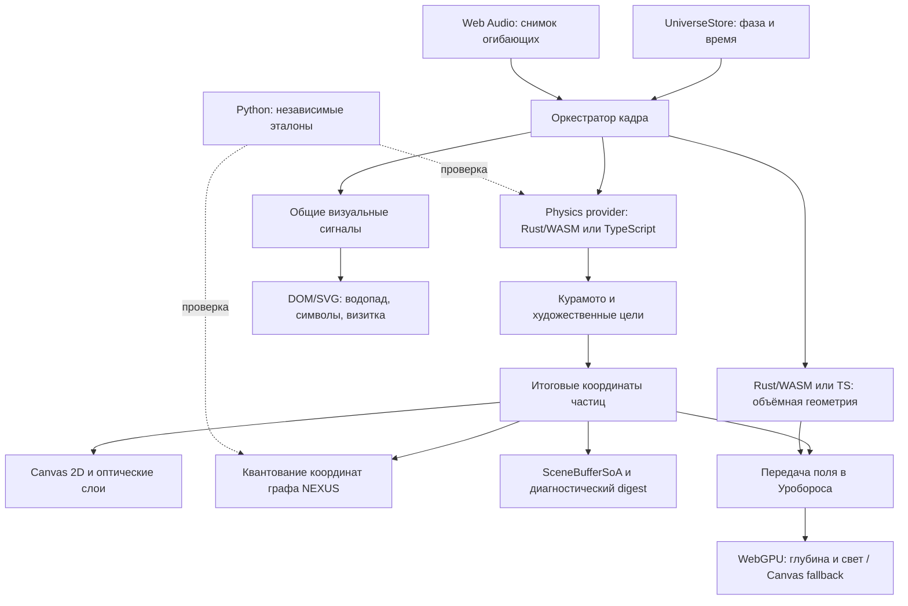

<!-- НАЗНАЧЕНИЕ: Устройство приложения, контракты данных и воспроизводимые проверки. -->
<!-- РАЗДЕЛЫ: 1. Конвейер; 2. Модули; 3. Память; 4. Время; 5. Представление; 6. Проверки. -->
# Архитектура UNIVERSE

UNIVERSE — статическое приложение Astro с общим состоянием сцены и управляемым циклом отрисовки. Один художественный мир представлен космической оптикой ILLUSION, топологией NEXUS и инженерным слоем X-RAY.

## 1. Конвейер кадра



Provider исполняется до художественных целей. Canvas читает итоговые particle-объекты, граф — квантование тех же координат, SoA — их публикацию. Объекты частиц, JS-массивы и линейная память WASM имеют разные представления; это не один общий непрерывный блок памяти.

## 2. Ответственность модулей

| Подсистема | Основные исходники | Роль |
|---|---|---|
| Оболочка | `frontend/src/pages/index.astro` | Холст, элементы управления и точки монтирования |
| Состояние | `store/universeState.ts`, `store/stressState.ts` | Фазы, пауза, оптическая линза и взаимодействия |
| Вход рендерера | `engine/renderer.ts`, `engine/bootstrap.ts` | Совместимый публичный фасад, запуск и привязка интерфейса |
| Оркестрация кадра | `engine/UniverseRenderer.ts`, `engine/pipeline.ts` | Основной RAF сцены, порядок проходов и High-DPI Canvas 2D |
| Процедурные поля | `engine/backgroundFields.ts`, `engine/math/noise2d.ts` | Детерминированные облака, полевые сигналы, сеть Z4 и общие функции шума |
| Проходы Canvas | `engine/passes/` | Космические поля, NEXUS, BREACH, сингулярность и выноски узлов |
| Объёмный эпизод | `core/ouroborosEpisode.ts`, `core/ouroborosModel.ts`, `core/ouroborosFieldMorph.ts`, `engine/ouroboros/`, `engine/webgpu/ouroboros.wgsl` | Геометрия Rust/TS, передача экранного поля, WebGPU и резервный Canvas |
| Синхронизация HUD | `engine/hud/hudDomOrchestrator.ts` | Канонические надписи, состояния управления и безопасные отступы доков |
| Хореография | `phases/01_void.ts`–`05_singularity.ts` | Целевые формы частиц и переходы |
| Физика | `bridge/wasmBridge.ts`, `physics_engine/src/` | Общая модель TS/Rust и непрерывный fallback |
| NEXUS | `bridge/simulationWorker.ts`, `bridge/nexusGraphWorker.ts`, `bridge/nexusGraphWorkerClient.ts`, `backend/core/graph_logic.py` | TS-граф в Web Worker (синхронный резерв) и независимый Python reference |
| Представление | `layers/Layer2_Metrics.tsx`–`Layer5_CipherFinale.tsx` | Монтируемые один раз DOM/SVG-панели |
| Путеводитель | `core/explainerTopics.ts`, `core/explainerTranslations.ts`, `layers/ExplanationDialog.ts`, `layers/explanationTrail.ts`, `layers/explanationTextReveal.ts`, `layers/explanationButtonMotion.ts`, `core/explanationAssembly.ts`, `engine/passes/explanationAssemblyPass.ts` | 15 тем на четырёх языках, нативная панель, сборка окна из пыли сцены и рассыпание при закрытии, вводный текст и внутренние призмы |
| Языки интерфейса | `core/locale.ts`, `engine/hud/localeController.ts` | RU/EN/HE/ES, подписки языка, сохранение источников текста и выбранная передняя / английская задняя грань |
| Декоративные сигналы | `core/visualSignals.ts`, `core/glyphGrammar.ts`, `core/glyphHover.ts` | Общий кадр, словарь и отклик символов |
| Геометрия интерфейса | `core/buttonSolid.ts` | Шесть граней CSS-кубоида, layout-размеры и доступная подпись внутри неподвижного элемента |
| Движение интерфейса | `core/buttonMotion.ts` | Полные обороты вокруг фиксированной оси, выравнивание передней грани и плавный разгон |
| Композиция финала | `core/finaleComposition.ts` | Общая геометрия яркого кольца и безопасного размещения визитки |
| Шрифты символов | `core/glyphFontAssets.json`, `assets/fonts/`, `frontend/public/fonts/LICENSE.txt` | Локальные наборы Noto как Vite-ресурсы, покрытие Unicode, хеши и лицензии OFL |
| Аудио | `utils/audioSync.ts` | Воспроизведение и сглаженные музыкальные параметры |
| Диагностика | `core/integrationRegistry.ts`, `core/resourceLedger.ts`, `core/frameDiagnostics.ts` | Статусы исполнителей, учёт ресурсов и опциональные интервалы кадров |

Rust/WASM загружается асинхронно. Успешный native-шаг даёт статус `WASM_ACTIVE`; `?wasm=0`, ошибка загрузки, несовместимый ABI или trap выбирают TypeScript. Python работает как локальный инструмент и эталон в проверках. NEXUS исполняется синхронно в TypeScript. Canvas 2D рисует основные пять фаз; отдельный прозрачный WebGPU-холст отображает объёмный эпизод Уробороса. `ouroboros.wgsl` исполняется в этом проходе, а `illusion.wgsl`, `truth.wgsl` и `breach.wgsl` остаются спецификациями.

`OuroborosEffect` выбирает WebGPU или Canvas fallback на общем кадре. GPU-инициализация проверяет компиляцию шейдера, настоящий offscreen draw с чтением пикселей и первую отправку на холст; только после этого реестр получает `READY`. В начале пятой фазы, до появления визитки в ACT D, проход заранее инициализируется невидимым кадром с нулевой прозрачностью. Это переносит компиляцию и pixel self-test из первого кадра появления; холст остаётся скрытым, источники поля и часы эпизода не изменяются. `probeWebGpuSupport()` обновляет возможности основного конвейера и не подменяет статус отдельного прохода. Ошибка устройства или инициализации скрывает GPU-холст и переводит эпизод на Canvas. `?gpu=0` принудительно выбирает Canvas, `?ouroboros=0` отключает эпизод.

`renderer.ts` подключает CSS, сохраняет именованные и default-экспорты и запускает клиентскую инициализацию. `bootstrap.ts` хранит активный экземпляр, предоставляет `getUniverseRenderer()` и связывает слои с управлением. Его `createUniverseResizeHandler()` завершает активный перебор каноническим текстом до пересчёта viewport, сохраняя один resize-слушатель. `UniverseRenderer.ts` владеет симуляцией и основным RAF сцены; его `renderFrame()` определяет последовательность Canvas-проходов. Модули `cosmosPass`, `nexusPass`, `breachPass`, `singularityPass` и `nodeCallout` получают необходимые данные для отрисовки и не создают собственных кадровых циклов.

`BackgroundFields` владеет изменяемым состоянием процедурного фона: `reset(seed)` создаёт 48 облаков, затем 8 сигналов, затем 136 узлов Z4 и их соседей; `step()` продвигает поля. Проходы читают `clouds`, `signals` и `nodes`. Порядок обращений к одному PRNG при создании полей сохраняет рисунок для заданного seed. Геометрия проходов задаётся в CSS-пикселях, а DPR применяется в `RenderPipeline`.

`engine/hud/keyboardShortcuts.ts` связывает команды с физическими кодами клавиш: `Shift+1`–`Shift+5` выбирают фазу, а `2`–`5` переключают инженерные слои. Обработчик пропускает системные сочетания, автоповтор, ввод составных символов, редактируемые поля и события из панели объяснений. При фокусе снаружи панели команды сцены доступны. Единственный слушатель освобождается через страничный disposer.

## 3. Память и численные контракты

`SceneBufferSoA` хранит 24-байтный little-endian заголовок `UNVS` версии 2 и отдельные типизированные массивы `id`, `kind`, `pos`, `vel`, `depthZ`, `energy`, `flags`. Запись проверяет конечность восьми числовых полей сущности. Выборочный FNV-1a digest помогает диагностировать состояние; совпадение хеша не доказывает равенства полной геометрии или экранных преобразований.

Raw Rust ABI v1 не требует imports или JS glue. Шаг, накопленное время и метрики передаются как `f64`, массивы — как `f32`. Положительный шаг ограничен `0.05 с` и разбивается на равные подшаги не более `0.004 с`. `step_verlet_nbody` возвращает статус `1`/`0`; host проверяет его до чтения результатов.

Оба provider рассчитывают фазы Курамото активных частиц и отдельный контрольный ансамбль `REF64`: 64 орбиты в статическом потенциале Пламмера. Фазы влияют на дыхание и поздний GENESIS. Энергетическая телеметрия описывает только контрольные орбиты. Художественная сцена не является полной N-body симуляцией.

При поздней загрузке WASM принимает актуальные TS-массивы, начальную энергию и накопленное время. После принятого native-шага обновляются TS-зеркала; при отказе расчёт продолжается от последнего целого состояния. Отклонённый upload требует отказаться от provider, поскольку его live-массивы не обеспечивают rollback.

`evaluate_lens_refraction(px, py, lensX, lensY, radius, reveal)` возвращает скалярную длину смещения при фиксированных `stress=0.25`, `time=0`. Проверки сравнивают этот reference с длиной нормализованного TS-вектора. Полная векторная оптика Canvas рассчитывается в TypeScript.

Для публикации графа TS/Python применяется `floor(value * scale + 0.5) / scale`, включая отрицательные ties к `+∞`. Кривые Безье используют таблицу накопленной длины по четырём хордам; обратная интерполяция уменьшает неравномерность движения. BFS использует шаг стартовых вершин `max(1, floor(Nactive / 28))`, а не жёсткий предел в 28 стартов.

Геометрия Уробороса имеет отдельный optional ABI версии 1: `get_ouroboros_abi_version`, `get_ouroboros_capacity`, `get_ouroboros_points_ptr`, `sample_ouroboros`. Буфер содержит до 3072 точек по восемь `f32`: позиция `x/y/z`, нормаль `nx/ny/nz`, размер и вид материала; шаг — 32 байта. Host проверяет контракт, границы памяти, число точек и конечность данных, затем копирует принятую геометрию в стабильный TS-буфер. `core/ouroborosModel.ts` предоставляет детерминированный fallback. Это декоративная геометрия, отдельная от физики, графа и `SceneBufferSoA`.

Стабильная часть пылевых индексов (`i % 16 === 6`, до 192 точек) движется внутри формы с разными скоростями и глубиной. Её матрица сохраняет покачивание X/Y без полного оборота тела по Z; общие часы задают непрерывные траектории, энергия меняет только амплитуду дыхания. Rust и TS рассчитывают одинаковые координаты без новых буферов, RAF или графических проходов. Передача экранных источников охватывает и внутреннюю пыль, сохраняя исходное облако и индексы качества.

`applyOuroborosFieldMorph()` связывает дополнительную форму с частью экранных источников, сохраняя исходные particle-объекты, топологию и видимость фонового облака. Центр формы совпадает с центром общего поля: `width / 2 + camera.driftX`, `height / 2 + camera.driftY`; отдельного нижнего смещения нет. Масштаб равен `0.232 * min(width, height)`. Уплощённая вытянутая морда расширяется к черепу, затем плавно округляется в туловище; небольшие световые точки обозначают глаза. Полуоси сечений `(0.106, 0.066)` при `u=0`, `(0.156, 0.100)` при `u=0.05` и `(tube, 1.06 * tube)` при `u=0.15` сопряжены quintic smootherstep с непрерывностью C². Нормали учитывают продольные производные полуосей и центральной линии. Конец хвоста входит в полость пасти; форма вращается головой вперёд с ограниченным покачиванием трёх осей. Стабильные индексы задают глаза `0/1`, губы `2/3`, хвост `4/5`, шею `8/9`, ширину черепа `10/11` и его глубину `16/17`. Остальные точки поверхности используют R2 с отдельной выборкой головы и шеи; выборка не зависит от длины буфера, число точек и ABI материалов сохраняются. WebGPU использует позиции и нормали для перспективных billboard-ядер с depth buffer, направленным светом и мягким световым проходом; Canvas отображает те же точки с освещением по нормалям, затуханием по глубине и сортировкой. Изображения двух исполнителей не обязаны быть попиксельно одинаковыми.

## 4. Время и жизненный цикл

Таймлайн пяти фаз, накопленное физическое время и позиция аудио имеют отдельные роли. Музыка не служит неявными часами физического provider и не перезапускается вместе с визуальным циклом.

Renderer публикует неизменяемый `VisualSignalSnapshot`. Нормализованный `frameDtSec` ограничен диапазоном `0..0.05 с` и равен нулю при паузе или скрытой вкладке. Водопад, движения кнопок и визитки накапливают этот шаг независимо от скачков абсолютного времени при смене фазы. Ограниченная по длительности сборка вводного текста путеводителя получает общий кадр, но измеряет время через `performance.now()`, согласованно с пылевой сборкой окна.

Водопад кеширует DOM-привязки после монтирования каскада; визитка, символы и водопад используют общие кадры. Эти DOM-потребители пропускают ненужные измерения и обновления скрытого или остановленного представления. Отписки и обработчики освобождаются при снятии соответствующего слоя. `QualityGovernor` хранит окно времени кадра и управляет профилем качества с гистерезисом; его p95 — текущая телеметрия, не результат бенчмарка.

Первое завершение сборки визитки запускает `finaleRiseElapsedSec`: общие часы её 12-секундного подъёма и появления объёмного эпизода. Уроборос собирается за 5.5 активной секунды, полная форма удерживается в начале следующей первой фазы ещё 7.6 секунды для завершения оборота, затем возвращается в поле за 7.2 секунды; свет затухает между 15 и 16.8 секунды первой фазы. Перед автоматическим или ручным переходом `05→01` store сохраняет `ouroborosRelease`: фактический возраст сборки и время ориентации. Повторный вход в финал использует локальное время сборки, поэтому сохранённый подъём карточки не вызывает мгновенного появления формы. Preview имеет 30-секундный цикл. Таймлайн сохраняет пять фаз и 108 секунд; отдельный RAF не создаётся. При паузе время и энергетический снимок эпизода сохраняются, reduced motion использует статичную форму. GPU-ресурсы относятся к времени жизни страницы; очистка и проверка поколения асинхронной инициализации препятствуют восстановлению снятого прохода.

Во время межциклового `RESTART_COLLAPSE` вращение продолжает идти от сохранённой ориентации через `restartElapsedSec`, а переход в VOID переносит уже достигнутое время. Полная форма в штатном автопроходе движется 14 активных секунд до начала рассеивания: 4.95 секунды финала, 1.45 секунды схлопывания и 7.6 секунды VOID. Степень сборки при ручном раннем выходе сохраняется; навигация не блокируется ради полного оборота. Пауза и скрытие страницы останавливают общие часы, а само межцикловое схлопывание не является паузой вращения.

## 5. Представление и доступность

`styles/universe.css` подключает семь соседних модулей в порядке 01–07: шрифты и базовые стили, HUD и объёмные кнопки, символьные барабаны, каскады, финальная визитка, адаптивные правила и `07-explanations.css`. Последний модуль оформляет термины, центральный док и окно объяснений со своими правилами ширины и уменьшения движения. Пути локальных шрифтов разрешаются относительно папки `styles/`.

В `CANONICAL_FINALE_LINES` строка моделей `SCRAMBLER · KURAMOTO · fBm · VERLET · PLUMMER` предшествует строке технологий `ASTRO · TYPESCRIPT/JAVASCRIPT · RUST/WASM · PYTHON · JSX/DOM · CANVAS2D · WEBGPU/WGSL · WEB AUDIO · HTML/CSS`. Пять моделей представлены стабильными нативными кнопками с `data-explain-topic`; техническая строка остаётся текстом. Каноническая сборка, перебор и адаптивный перенос сохраняют порядок строк и доступные подписи.

`mountExplanationDialog()` из `layers/ExplanationDialog.ts` монтирует один `<dialog>` на страницу. Входы — пять моделей и объёмная кнопка `btn-explanation-overview` внизу по центру, рядом с `btn-language`. У всех вращающихся элементов передняя грань использует выбранный язык, задняя — английский; исходный RU показывает «КАК ЭТО УСТРОЕНО» спереди и `HOW IT WORKS` сзади. На desktop панель расположена слева под brand-card, симметрично правой телеметрии; от `1840px` окно и шкала фаз под ним образуют один столбец шириной `min(512px, 50vw − 452px)`, кнопки фаз стоят по центру. До `920px` панель путеводителя и коллекция инспекторов используют коридор между измеренными `--hud-top-inset` и `--hud-bottom-inset`, сохраняя доступ к HUD. Каталог `core/explainerTopics.ts` и переводы `core/explainerTranslations.ts` предоставляют все 15 тем, технические абзацы, подписи формул и источников на RU/EN/HE/ES. MathML и пути файлов сохраняются; текстовая формула остаётся доступной.

`core/locale.ts` хранит выбранный язык и словари UI/событий, начиная с RU и учитывая сохранённый выбор. `mountLocaleControls()` из `engine/hud/localeController.ts` монтируется после объёмных тел: кнопка циклически выбирает RU → EN → HE → ES, обновляются `document.lang/dir`, исходные текстовые узлы и атрибуты. Сканирование выполняется только при выборе языка; динамические подписи и логи проходят через `setHudText`, поздние JSX-панели сохраняют исходники строк. Подписка визитки на язык завершает декоративные сеансы и заново строит её локализованное представление, обновляя видимый канон и доступные подписи также на паузе. Состояние симуляции не изменяется. RTL-текст иврита сохраняет физическую компоновку HUD. Верхняя плашка содержит кодовое имя, название и подзаголовок фазы. На обеих широких гранях кнопок фаз сохраняются числовой код и название; длинные переводы допускают перенос.

Нативный `<dialog>` открывается через `show()` как немодальная панель. Сцена, смена фаз, звук и остальные кнопки продолжают работу. Клавиатурный guard действует при фокусе внутри панели, где Esc закрывает её; фокус свободно переходит к другим элементам. Состояние паузы и прокрутка страницы остаются под управлением посетителя. Страничный disposer освобождает панель и её обработчики. Внешний выбор модели обновляет тему и повторяет пылевую сборку, внутренняя навигация меняет содержание.

Окно собирается из пыли сцены: `core/explanationAssembly.ts` — общие часы и детерминированное поле (`560`/`300` песчинок, `42%` на рамке в `4px` снаружи окна, `12%` из нажатой кнопки, остальные — от реальных частиц, не больше ~`4` песчинок от одной), `engine/passes/explanationAssemblyPass.ts` — рисунок в основном Canvas спрайтами атласа без `shadowBlur` и второго холста, `layers/explanationTrail.ts` — поза окна. Пыль летит со всех сторон, где в сцене есть частицы, напрямую по мягкой дуге к ближней части окна и с `55%` пути ввинчивается в свою точку спиралью; общего вихря нет. Полёт длится `3600 мс`, окно проявляется на месте с `3000` до `3900 мс`, плоскость из пыли гаснет под ним, а рамка остаётся светиться, пока окно открыто. Закрытие рассыпает песчинки обратно к их частицам за `1600 мс` — с того кадра, который был на экране, даже посреди полёта. Resize, скрытие, повторная сборка и снятие окна убирают пыль сразу и освобождают кадр, слушатели и буфер поля. Reduced motion пропускает эффект; внутренняя навигация сохраняет текущую сборку.

Контуры и падающие символы используют каскад `5` системы Starfall из `layers/Layer2_Metrics.tsx` на общем кадре. Панель привязывает его при открытии и освобождает при закрытии. Действуют те же настройки, что справа: начальная задержка `0.5 с`, интервал `0.58–1.5 с`, исходная непрозрачность `0.86` и общая физика падения. Отдельный счётчик сохраняет последовательности каскадов `2–4`. Текстовые слоты всех каскадов имеют `transform: none`, постоянный цвет и мягко меняющееся музыкальное свечение. Левый SVG использует физические CSS-пиксели в `viewBox="0 0 width height"`, поэтому высота окна сохраняет амплитуду волны. Размер читается при открытии и через `ResizeObserver`, который действует только у открытой панели. `resizeCascadeContour()` кеширует размеры, а общий кадр использует кеш; закрытие отключает observer. Контуры справа сохраняют систему `418×280`.

`layers/explanationTextReveal.ts` собирает вводные абзацы на общем визуальном кадре: после внешнего открытия задержка равна времени проявления окна (`3900 мс`), упорядоченная сборка — `1000 мс`, затем `200 мс` C²-перехода от вписанного слоя к нативному тексту. Все этапы используют монотонное время `performance.now()`: ограниченный шаг физики не растягивает задержку на медленных кадрах. Обрабатываются максимум `240` графем на абзац; остаток скрыт до передачи видимости нативному тексту. Нативная мера сохраняет переносы, RTL, диакритику и доступный текст; декоративные глифы вписываются целиком в неподвижные окна и поворачиваются вокруг Y плоской проекцией `scaleX(cos θ)` без 3D-слоёв. Порядок — сверху вниз, физически слева направо для каждого языка. Чтения предшествуют записям; сеанс освобождается при завершении, смене содержания, закрытии, resize, скрытии или смене шрифта. Открытие на паузе и reduced motion показывают канон сразу; пауза во время сборки завершает её полным читаемым текстом. Панель использует свободную левую ширину и высоту; прокрутка появляется только при необходимости.

`layers/explanationButtonMotion.ts` обслуживает `18` внутренних призм одной подпиской на общий визуальный кадр. Локальная глубина равна `clamp(12px, height × 0.58, 26px)`, покачивание ограничено `±10°`; наведение и фокус плавно выравнивают тело. Медленные детерминированные блики граней используют отдельные индексные сдвиги и непрерывные активные часы. Пауза и reduced motion сохраняют статичный свет. Передняя грань использует выбранный язык, задняя — английский. Два режима образуют равные половины с мягким 20-секундным переливом надписей и акцентом выбранного режима. Под ними расположен волновой SVG-разделитель шириной `2/3` панели, обновляемый общим каскадом. `07-explanations.css` центрирует заголовок и подзаголовки разделов, включая источники, и сохраняет запас `2px` при вписывании букв в грани. Внешний `<dialog>` имеет `overflow: hidden`; единственный вертикальный scroller объяснения — `.explanation-panel` с высотой `fieldHeight − 56px`, внешними полями `28px 30px` и внутренними отступами `0 4px 4px`. Минимальный боковой зазор текста равен `34px`, верхняя и нижняя границы области чтения отстоят от рамки на `28px`. SVG и падающие символы находятся вне scroller. Header закреплён на `top: 0` внутри безопасной области; до `920px` при высоте до `520px` он прокручивается с текстом. Его отступы защищают выступ призм, а `scrollbar-gutter: stable` сохраняет ширину при смене содержания.

В общей теме путеводителя закрытый по умолчанию блок «О музыке» показывает `SOUNDTRACK_CREDIT` из `utils/audioSync.ts`: Photosynthesis, Carbon Based Lifeforms, World of Sleepers. Названия композиции, исполнителя и альбома сохраняются, подписи полей переводятся на RU/EN/HE/ES. Эта справка не меняет воспроизведение.

`04-waterfall-cascades.css` оставляет справа зазор `gx = width × 23.5 / 418 + 8px` и `gy = height × 16.3 / 280 + 6px`. Вертикальный зазор реализован тремя grid-строками `0.058214fr / 0.883572fr / 0.058214fr` с базовым padding `6.7906px`; абсолютный контур сохраняет внешний размер. В диапазоне `921–1280px` веса METRICS / TOPOLOGY / TERMINAL равны `0.97 / 0.92 / 1.11`, длинные метки переносятся, интервалы топологии равны `0.2rem`. Восемь строк реестра сохраняются; минимальная высота журнала равна одной строке (`1lh`), строки используют ellipsis. До `920px` средняя grid-строка получает `min-content`, панели рассчитывают высоту по содержимому, слоты используют `flex: 0 0 auto`; при избытке высоты прокручивается общая коллекция правых панелей.

Декоративный перебор статических строк и действий визитки сохраняет точный канонический текст и доступное имя элемента. Для generic `p/span` канон находится в отдельном доступном span, а декоративное представление помечено `aria-hidden`. Кнопки, ссылки и заголовки сохраняют стабильные доступные названия. Центральная квантовая строка из 25 ячеек и символы водопада имеют собственные представления.

При наведении целый знак перелистывается вокруг Y: исходящий слой `0→90°`, затем входящий `−90→0°`; одновременно виден один слой. Равномерный масштаб учитывает ширину и высоту начертания, выносы и базовую линию без расширения ячейки. При закреплении раскрывается исходная наборная мера с точным tracking. Два оборота и LTR-фронт сохраняют порядок сборки; жёсткая маска, разрезающая движущийся знак, не используется.

Первичная DOM-сборка также использует отдельные ink-слои в ячейках, измеренных по каноническому тексту. Изменённые начертания сначала измеряются пакетом, затем записываются текст и стили. Тот же порядок «все чтения, затем записи» применяется к постоянным 25 ячейкам и исходящим/входящим слоям hover-барабанов. Кеш метрик окна использует поколение шрифта, viewport и размер строки; изменение одного глифа не требует повторного `getComputedStyle`. Кеш начертаний ограничен 4096 записями. Центральная строка пересчитывает вписывание при смене шрифта или размеров ячейки без изменения символьных часов. Ранний Canvas-одометр вписывает основные и ghost-знаки с теми же метриками полного начертания и учитывает границы viewport; его кеш ограничен и сбрасывается при смене шрифтов.

Проверка доступных символов в `glyphGrammar.ts` распределяет Canvas raster readback по общим кадрам: не более четырёх чтений за кадр, включая эталоны отсутствующего знака. До подтверждения начертаний используется безопасный базовый пул; готовый фазовый пул кешируется.

В основных меню подпись `link-hud-github` получает перелив нагретого металла с бордовым свечением: янтарный, коралловый, розовый и голубой оттенки плавно сменяются за 18 активных секунд. Пауза и reduced motion сохраняют текущий цвет; внутренние переключатели путеводителя используют описанный выше мягкий перелив. Общий компактный масштаб HUD задан токеном `--hud-compact-scale: 0.75`; геометрия, тени и увеличение при чтении управляются существующими контроллерами.

Глифы перечисляются полными Unicode code point. Локальные наборы Noto из `src/assets/fonts/` содержат выбранные знаки, а `glyphFontAssets.json` задаёт файлы с хешами, диапазоны Unicode и источники лицензий. CSS и preload используют одни и те же URL сборки Vite; исходные лицензии публикуются в `fonts/LICENSE.txt`. Кешируемый фильтр проверяет начертания; системный font stack и базовый ASCII-пул служат fallback. Исторические знаки используются как художественные символы без вымышленного перевода.

Три угловых меню используют замкнутые CSS-кубоиды с шестью непрозрачными гранями и читаемыми подписями на передней и задней сторонах. `buttonSolid.ts` сохраняет неподвижный native host и его область взаимодействия; скрытый измеритель остаётся в обычном потоке, а `ResizeObserver` обновляет геометрию по layout border box. Декоративное тело имеет `aria-hidden`; доступный канон находится отдельно или в native `aria-label`. По умолчанию задняя грань повторяет переднюю; `data-solid-back-label` задаёт отдельную подпись, как у кнопки путеводителя. `setSolidButtonLabel()` сохраняет грани, обновляет канон и учитывает заданную заднюю подпись. Задняя копия декоративна, не содержит повторных идентификаторов и DOM-привязок и не создаёт второй доступный элемент. Компактный масштаб оболочки и тела освобождает сцену; область нажатия остаётся неподвижной. Наведение и видимый клавиатурный фокус увеличивают выбранное тело для чтения без перестроения меню. Строки верхнего информационного блока сохраняют семантику текста и заголовков.

`buttonMotion.ts` задаёт вложенному телу полные обороты через `rotate3d`: фиксированная нормированная ось и накопленный угол сохраняют направление и непрерывность. Центр host остаётся неподвижным. Элементы имеют индивидуальные скорости и направления, а сигналы сцены и музыки плавно меняют угловую скорость. Наведение или видимый клавиатурный фокус выравнивает переднюю грань по ближайшему полному обороту с C²-огибающей; остальные элементы продолжают вращаться. После отпускания тело плавно разгоняется от текущего угла. Контроллеры освобождают привязки и наблюдатели; отдельный цикл RAF не создаётся.

Собственная тень каждого host рисуется отдельным `::before`. Её смещение, размытие, прозрачность и масштаб по двум осям рассчитываются из текущего поворота и публикуются не чаще 12 Гц общего кадра. Пауза и нулевой шаг сохраняют параметры; снятие привязки восстанавливает прежние значения. `filter` применяется только к тени, поэтому `preserve-3d` корпуса сохраняется. Общие CSS-параметры масштаба и сдвига согласуют тень с увеличением выбранного тела. Мобильная компоновка центрирует плашки и учитывает безопасные отступы экрана. До 600px ширина нижних меню компенсирует `zoom`, заполняя окно с полями; увеличенные межрядные интервалы резервируют размах вращающихся тел. Верхняя плашка и настольная раскладка сохраняют компактный масштаб.

Визитка сначала раскрывается в центре финальной сцены, а после полной сборки плавно занимает верхнюю свободную область с зазором над светлой областью фотонного ореола. `finaleComposition.ts` задаёт общую геометрию ореола и размещения карточки в CSS-пикселях, включая огибающую её дыхания; DPR применяется в Canvas pipeline. `bindHudDockLayout()` из `engine/hud/hudDomOrchestrator.ts` измеряет верхнее меню и нижний док через `ResizeObserver` и передаёт безопасные отступы в `--hud-top-inset` и `--hud-bottom-inset`, чтобы карточка учитывала перенос увеличенных кнопок. Пауза сохраняет положение; reduced motion использует статичное представление. На низких экранах ограничение подъёма сохраняет доступность текста и действий; полный зазор над ореолом зависит от свободного места.

На всех экранах конечный подъём использует максимально доступное верхнее положение с запасом для дыхания: безопасная граница равна 8px на desktop, а до 920px учитывает верхний HUD с дополнительными 4px, минимальную границу 48px и padding сцены. Текущая масштабированная высота ограничивает подъём, чтобы сохранять все строки и действия. Только до 600px последние шесть секунд общего 12-секундного подъёма плавно уменьшают карточку до масштаба `0.82`; при ширине от 601px масштаб остаётся `1`. Пауза сохраняет размер, reduced motion выбирает конечное статичное положение.

В `06-responsive.css` при ширине от 921px три действия визитки помещаются в одну строку без переноса; их компактная типографика использует `0.68rem`. На desktop высотой до 800px меньшие вертикальные интервалы и padding сохраняют все информационные строки. В диапазоне 601–920px квантовая сетка размещает 25 ячеек в один ряд, сохраняя размер шрифта. Телефонная компоновка остаётся отдельной.

## 6. Воспроизводимые проверки

Из корня репозитория:

```sh
npm ci
rustup target add wasm32-unknown-unknown
npm run verify:all
```

Нужны Node.js `>=22.23.4`, Python `3.11+` и Rust. Зависимости устанавливаются по lock-файлу. Общая команда выполняет проверку полноты исходников, Python verifier/unittest, native Rust, TypeScript, графический lifecycle harness, сборку и интеграции реального WASM, Astro и проверку Pages-артефакта.

`build:wasm` использует release-профиль `physics_engine/Cargo.toml`: `opt-level = 3`, `lto = true`, `codegen-units = 1`, `panic = "abort"`. Численные контракты и ABI проверяются на собранном артефакте; размер и время исполнения зависят от компилятора и требуют отдельных измерений.

`verify:repo` сверяет литеральные относительные импорты с точными путями индекса Git, включая регистр символов, re-export, динамический `import()` с постоянным путём и ресурсы с query-суффиксом. Поэтому отсутствующий в коммите модуль обнаруживается и на чистом checkout; самопроверки разрешения путей запускаются вместе с проверкой репозитория.

Отдельные команды: `npm run typecheck`, `npm test`, `npm run test:python`, `npm run test:rust`, `npm run verify:graphics`, `npm run build:wasm`, `npm run verify:wasm`, `npm run build`, `npm run verify:pages-artifact`.

Численные проверки охватывают PRNG, бинарный протокол, NEXUS, шаг времени, перенос состояния и fallback, оптический reference и связь native-фаз с публикуемой геометрией. Общие fixtures описывают конкретные входы; они не являются доказательством эквивалентности всех возможных графов. DOM-регрессии проверяют доступность, восстановление текста и жизненный цикл анимации.

`frontend/scripts/verify-graphics-runtime.mjs` исполняет настоящие `OuroborosGpuRenderer` и `OuroborosEffect` с управляемым WebGPU mock. Он проверяет отложенную готовность, невидимый предварительный запуск до ACT D, ошибки, освобождение во время асинхронной инициализации, изменение поля при фиксированных часах, повтор неудавшейся отправки, паузу/reduced motion и освобождение Canvas-атласа. Проверка не компилирует WGSL драйвером и не заменяет браузерную проверку изображения на настоящем GPU.

Визуальная приёмка включает последовательность фаз, повтор цикла, размер viewport, управление с клавиатуры и указателя, паузу/reduced motion, загрузку/отказ WASM и политику автозапуска звука. Производительность сравнивается на одинаковом устройстве, seed и профиле после прогрева.

Для локальной проверки задержек параметр `?profile=1` включает `FrameDiagnostics`. В `data-frame-profile` основного холста публикуются реальные интервалы между RAF, CPU-время кадра, максимумы и число интервалов свыше 100/500/1000 мс отдельно по фазе и акту. Измеренный интервал не обрезается до шага физики `0.05 с`; пауза, скрытая вкладка и первое возобновление не считаются зависанием активной сцены. Обработчик `visibilitychange` сбрасывает непрерывность измерений даже без скрытого RAF. Журнал ограничен агрегатами по стадиям, работает на существующем RAF и выключен в обычном просмотре. Дополнительный `dpr=3` в режиме профилирования проверяет телефонную плотность backing store с обычными ограничениями профиля качества; без `profile=1` он не действует. Эмуляция viewport и DPR не заменяет проверку браузера на физическом телефоне.

Диагностика отдельно сохраняет максимальное время подготовки, симуляции, UI и рендера, а также подписчиков общего визуального сигнала: кнопок, водопада, визитки и активного перебора. Время симуляции и UI включает их синхронные подписки на store. Начальная визитка заранее создаёт скрытые символьные ячейки; измерения четырёх наборных строк и квантовой сетки завершаются до единого пакета записей текста и transform. Неизменившиеся значения HUD и состояния доступности не перезаписываются.

На ширинах 921–1730px центральная визитка и правые инспекторы получают раздельные полосы чтения. Ширина инспекторов ограничена 22vw, ширина карточки — свободной центральной областью. На ширинах до 1280px дополнительно уплотняются подписи действий и горизонтальные поля инспекторов без удаления сведений; в диапазоне 921–1280px подписи ссылок допускают перенос внутри кнопок, не создавая горизонтальный скролл карточки.

[Технический справочник](../UNIVERSE_BIBLE.md) · [Решение о вычислительных модулях](ADR-001-POLYGLOT-RUNTIME.md) · [Математические модели](study_materials/MATHEMATICAL_AND_ASTROPHYSICAL_MODELS.md)
