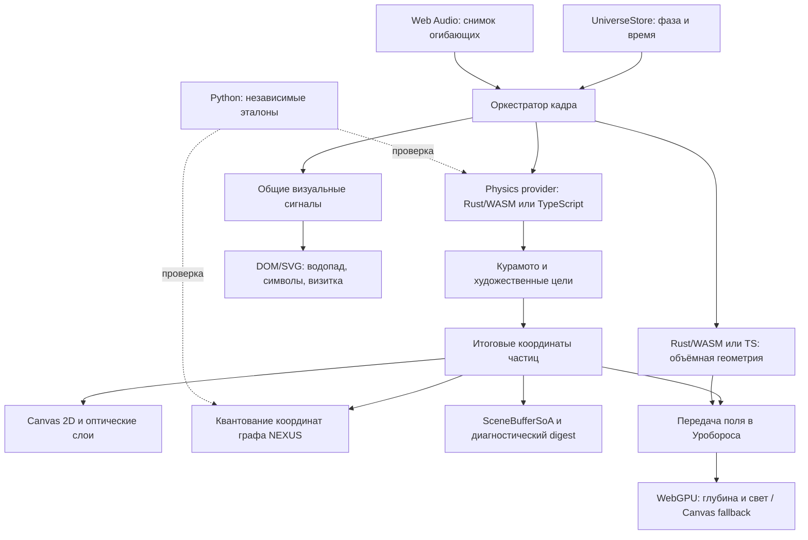

<!-- НАЗНАЧЕНИЕ: Устройство приложения, контракты данных и воспроизводимые проверки. -->
<!-- РАЗДЕЛЫ: 1. Конвейер; 2. Модули; 3. Память; 4. Время; 5. Представление; 6. Проверки. -->
# Архитектура UNIVERSE

UNIVERSE — статическое приложение Astro с общим состоянием сцены и управляемым циклом отрисовки. Один художественный мир представлен космической оптикой ILLUSION, топологией NEXUS и инженерным слоем X-RAY.

## 1. Конвейер кадра



Provider исполняется до художественных целей. Canvas читает итоговые particle-объекты, граф — квантование тех же координат, SoA — их публикацию. Объекты частиц, JS-массивы и линейная память WASM имеют разные представления; это не один общий непрерывный блок памяти.

## 2. Ответственность модулей

| Подсистема | Основные исходники | Роль |
|---|---|---|
| Оболочка | `frontend/src/pages/index.astro` | Холст, элементы управления и точки монтирования |
| Состояние | `store/universeState.ts`, `store/stressState.ts` | Фазы, пауза, оптическая линза и взаимодействия |
| Вход рендерера | `engine/renderer.ts`, `engine/bootstrap.ts` | Совместимый публичный фасад, запуск и привязка интерфейса |
| Оркестрация кадра | `engine/UniverseRenderer.ts`, `engine/pipeline.ts` | Единственный RAF, порядок проходов и High-DPI Canvas 2D |
| Процедурные поля | `engine/backgroundFields.ts`, `engine/math/noise2d.ts` | Детерминированные облака, полевые сигналы, сеть Z4 и общие функции шума |
| Проходы Canvas | `engine/passes/` | Космические поля, NEXUS, BREACH, сингулярность и выноски узлов |
| Объёмный эпизод | `core/ouroborosEpisode.ts`, `core/ouroborosModel.ts`, `core/ouroborosFieldMorph.ts`, `engine/ouroboros/`, `engine/webgpu/ouroboros.wgsl` | Геометрия Rust/TS, передача экранного поля, WebGPU и резервный Canvas |
| Синхронизация HUD | `engine/hud/hudDomOrchestrator.ts` | Канонические надписи, состояния управления и безопасные отступы доков |
| Хореография | `phases/01_void.ts`–`05_singularity.ts` | Целевые формы частиц и переходы |
| Физика | `bridge/wasmBridge.ts`, `physics_engine/src/` | Общая модель TS/Rust и непрерывный fallback |
| NEXUS | `bridge/simulationWorker.ts`, `backend/core/graph_logic.py` | Синхронный TS-граф и независимый Python reference |
| Представление | `layers/Layer2_Metrics.tsx`–`Layer5_CipherFinale.tsx` | Монтируемые один раз DOM/SVG-панели |
| Декоративные сигналы | `core/visualSignals.ts`, `core/glyphGrammar.ts`, `core/glyphHover.ts` | Общий кадр, словарь и отклик символов |
| Геометрия интерфейса | `core/buttonSolid.ts` | Шесть граней CSS-кубоида, layout-размеры и доступная подпись внутри неподвижного элемента |
| Движение интерфейса | `core/buttonMotion.ts` | Полные обороты вокруг фиксированной оси, выравнивание передней грани и плавный разгон |
| Композиция финала | `core/finaleComposition.ts` | Общая геометрия яркого кольца и безопасного размещения визитки |
| Шрифты символов | `core/glyphFontAssets.json`, `assets/fonts/`, `frontend/public/fonts/LICENSE.txt` | Локальные наборы Noto как Vite-ресурсы, покрытие Unicode, хеши и лицензии OFL |
| Аудио | `utils/audioSync.ts` | Воспроизведение и сглаженные музыкальные параметры |
| Диагностика | `core/integrationRegistry.ts`, `core/resourceLedger.ts` | Статусы исполнителей и учёт ресурсов |

Rust/WASM загружается асинхронно. Успешный native-шаг даёт статус `WASM_ACTIVE`; `?wasm=0`, ошибка загрузки, несовместимый ABI или trap выбирают TypeScript. Python работает как локальный инструмент и эталон в проверках. NEXUS исполняется синхронно в TypeScript. Canvas 2D рисует основные пять фаз; отдельный прозрачный WebGPU-холст отображает объёмный эпизод Уробороса. `ouroboros.wgsl` исполняется в этом проходе, а `illusion.wgsl`, `truth.wgsl` и `breach.wgsl` остаются спецификациями.

`OuroborosEffect` выбирает WebGPU или Canvas fallback на общем кадре. GPU-инициализация проверяет компиляцию шейдера, настоящий offscreen draw с чтением пикселей и первую отправку на холст; только после этого реестр получает `READY`. `probeWebGpuSupport()` обновляет возможности основного конвейера и не подменяет статус отдельного прохода. Ошибка устройства или инициализации скрывает GPU-холст и переводит эпизод на Canvas. `?gpu=0` принудительно выбирает Canvas, `?ouroboros=0` отключает эпизод.

`renderer.ts` подключает CSS, сохраняет именованные и default-экспорты и запускает клиентскую инициализацию. `bootstrap.ts` хранит активный экземпляр, предоставляет `getUniverseRenderer()` и связывает слои с управлением. Его `createUniverseResizeHandler()` завершает активный перебор каноническим текстом до пересчёта viewport, сохраняя один resize-слушатель. `UniverseRenderer.ts` владеет симуляцией и единственным RAF; его `renderFrame()` определяет последовательность Canvas-проходов. Модули `cosmosPass`, `nexusPass`, `breachPass`, `singularityPass` и `nodeCallout` получают необходимые данные для отрисовки и не создают собственных кадровых циклов.

`BackgroundFields` владеет изменяемым состоянием процедурного фона: `reset(seed)` создаёт 48 облаков, затем 8 сигналов, затем 136 узлов Z4 и их соседей; `step()` продвигает поля. Проходы читают `clouds`, `signals` и `nodes`. Порядок обращений к одному PRNG при создании полей сохраняет рисунок для заданного seed. Геометрия проходов задаётся в CSS-пикселях, а DPR применяется в `RenderPipeline`.

`engine/hud/keyboardShortcuts.ts` связывает команды с физическими кодами клавиш: `Shift+1`–`Shift+5` выбирают фазу, а `2`–`5` переключают инженерные слои. Обработчик пропускает системные сочетания, автоповтор, ввод составных символов и редактируемые поля. Единственный слушатель освобождается через страничный disposer.

## 3. Память и численные контракты

`SceneBufferSoA` хранит 24-байтный little-endian заголовок `UNVS` версии 2 и отдельные типизированные массивы `id`, `kind`, `pos`, `vel`, `depthZ`, `energy`, `flags`. Запись проверяет конечность восьми числовых полей сущности. Выборочный FNV-1a digest помогает диагностировать состояние; совпадение хеша не доказывает равенства полной геометрии или экранных преобразований.

Raw Rust ABI v1 не требует imports или JS glue. Шаг, накопленное время и метрики передаются как `f64`, массивы — как `f32`. Положительный шаг ограничен `0.05 с` и разбивается на равные подшаги не более `0.004 с`. `step_verlet_nbody` возвращает статус `1`/`0`; host проверяет его до чтения результатов.

Оба provider рассчитывают фазы Курамото активных частиц и отдельный контрольный ансамбль `REF64`: 64 орбиты в статическом потенциале Пламмера. Фазы влияют на дыхание и поздний GENESIS. Энергетическая телеметрия описывает только контрольные орбиты. Художественная сцена не является полной N-body симуляцией.

При поздней загрузке WASM принимает актуальные TS-массивы, начальную энергию и накопленное время. После принятого native-шага обновляются TS-зеркала; при отказе расчёт продолжается от последнего целого состояния. Отклонённый upload требует отказаться от provider, поскольку его live-массивы не обеспечивают rollback.

`evaluate_lens_refraction(px, py, lensX, lensY, radius, reveal)` возвращает скалярную длину смещения при фиксированных `stress=0.25`, `time=0`. Проверки сравнивают этот reference с длиной нормализованного TS-вектора. Полная векторная оптика Canvas рассчитывается в TypeScript.

Для публикации графа TS/Python применяется `floor(value * scale + 0.5) / scale`, включая отрицательные ties к `+∞`. Кривые Безье используют таблицу накопленной длины по четырём хордам; обратная интерполяция уменьшает неравномерность движения. BFS использует шаг стартовых вершин `max(1, floor(Nactive / 28))`, а не жёсткий предел в 28 стартов.

Геометрия Уробороса имеет отдельный optional ABI версии 1: `get_ouroboros_abi_version`, `get_ouroboros_capacity`, `get_ouroboros_points_ptr`, `sample_ouroboros`. Буфер содержит до 3072 точек по восемь `f32`: позиция `x/y/z`, нормаль `nx/ny/nz`, размер и вид материала; шаг — 32 байта. Host проверяет контракт, границы памяти, число точек и конечность данных, затем копирует принятую геометрию в стабильный TS-буфер. `core/ouroborosModel.ts` предоставляет детерминированный fallback. Это декоративная геометрия, отдельная от физики, графа и `SceneBufferSoA`.

`applyOuroborosFieldMorph()` связывает дополнительную форму с частью экранных источников, сохраняя исходные particle-объекты, топологию и видимость фонового облака. Масштаб формы равен `0.232 * min(width, height)`; голова включает челюстной объём и две устойчивые яркие точки глаз. WebGPU использует позиции и нормали для перспективных billboard-ядер с depth buffer и мягкого светового прохода; Canvas отображает те же точки с упрощённым освещением и сортировкой по глубине. Изображения двух исполнителей не обязаны быть попиксельно одинаковыми.

## 4. Время и жизненный цикл

Таймлайн пяти фаз, накопленное физическое время и позиция аудио имеют отдельные роли. Музыка не служит неявными часами физического provider и не перезапускается вместе с визуальным циклом.

Renderer публикует неизменяемый `VisualSignalSnapshot`. Нормализованный `frameDtSec` ограничен диапазоном `0..0.05 с` и равен нулю при паузе или скрытой вкладке. Декоративные потребители накапливают этот шаг независимо от скачков абсолютного времени при смене фазы.

Водопад кеширует DOM-привязки после монтирования каскада; визитка, символы и водопад используют общие кадры. Эти DOM-потребители пропускают ненужные измерения и обновления скрытого или остановленного представления. Отписки и обработчики освобождаются при снятии соответствующего слоя. `QualityGovernor` хранит окно времени кадра и управляет профилем качества с гистерезисом; его p95 — текущая телеметрия, не результат бенчмарка.

Первое завершение сборки визитки запускает `finaleRiseElapsedSec`: общие часы её 12-секундного подъёма и появления объёмного эпизода. Уроборос собирается за 5.5 активной секунды, а начало следующей первой фазы возвращает его в поле за 5.2 секунды со световым затуханием между 5.4 и 6.8 секунды. Перед автоматическим или ручным переходом `05→01` store сохраняет `ouroborosRelease`: фактический возраст сборки и время ориентации. Повторный вход в финал использует локальное время сборки, поэтому сохранённый подъём карточки не вызывает мгновенного появления формы. Preview имеет 20-секундный цикл. Таймлайн сохраняет пять фаз и 108 секунд; отдельный RAF не создаётся. При паузе время и энергетический снимок эпизода сохраняются, reduced motion использует статичную форму. GPU-ресурсы относятся к времени жизни страницы; очистка и проверка поколения асинхронной инициализации препятствуют восстановлению снятого прохода.

## 5. Представление и доступность

`styles/universe.css` подключает шесть соседних модулей в порядке 01–06: шрифты и базовые стили, HUD и объёмные кнопки, символьные барабаны, каскады, финальная визитка, адаптивные правила. Медиазапросы ширины и уменьшения движения находятся в последнем модуле; общие составные селекторы сохраняются целиком. Пути локальных шрифтов разрешаются относительно той же папки `styles/`.

Декоративный перебор статических строк и действий визитки сохраняет точный канонический текст и доступное имя элемента. Для generic `p/span` канон находится в отдельном доступном span, а декоративное представление помечено `aria-hidden`. Кнопки, ссылки и заголовки сохраняют стабильные доступные названия. Центральная квантовая строка из 25 ячеек и символы водопада имеют собственные представления.

При наведении целый знак перелистывается вокруг Y: исходящий слой `0→90°`, затем входящий `−90→0°`; одновременно виден один слой. Равномерный масштаб учитывает ширину и высоту начертания, выносы и базовую линию без расширения ячейки. При закреплении раскрывается исходная наборная мера с точным tracking. Два оборота и LTR-фронт сохраняют порядок сборки; жёсткая маска, разрезающая движущийся знак, не используется.

Только подпись `link-hud-github` получает перелив нагретого металла с бордовым свечением: янтарный, коралловый, розовый и голубой оттенки плавно сменяются за 18 активных секунд. Пауза и reduced motion сохраняют текущий цвет; остальные кнопки используют прежнюю палитру. Общий компактный масштаб HUD задан токеном `--hud-compact-scale: 0.75`; геометрия, тени и увеличение при чтении управляются существующими контроллерами.

Глифы перечисляются полными Unicode code point. Локальные наборы Noto из `src/assets/fonts/` содержат выбранные знаки, а `glyphFontAssets.json` задаёт файлы с хешами, диапазоны Unicode и источники лицензий. CSS и preload используют одни и те же URL сборки Vite; исходные лицензии публикуются в `fonts/LICENSE.txt`. Кешируемый фильтр проверяет начертания; системный font stack и базовый ASCII-пул служат fallback. Исторические знаки используются как художественные символы без вымышленного перевода.

Три угловых меню используют замкнутые CSS-кубоиды с шестью непрозрачными гранями и подписью на передней. `buttonSolid.ts` сохраняет неподвижный native host и его область взаимодействия; скрытый измеритель остаётся в обычном потоке, а `ResizeObserver` обновляет геометрию по layout border box. Декоративное тело имеет `aria-hidden`; доступный канон находится отдельно или в native `aria-label`. `setSolidButtonLabel()` сохраняет грани при обновлении текста. Компактный масштаб оболочки и тела освобождает сцену; область нажатия остаётся неподвижной. Наведение и видимый клавиатурный фокус увеличивают выбранное тело для чтения без перестроения меню. Строки верхнего информационного блока сохраняют семантику текста и заголовков.

`buttonMotion.ts` задаёт вложенному телу полные обороты через `rotate3d`: фиксированная нормированная ось и накопленный угол сохраняют направление и непрерывность. Центр host остаётся неподвижным. Элементы имеют индивидуальные скорости и направления, а сигналы сцены и музыки плавно меняют угловую скорость. Наведение или видимый клавиатурный фокус выравнивает переднюю грань по ближайшему полному обороту с C²-огибающей; остальные элементы продолжают вращаться. После отпускания тело плавно разгоняется от текущего угла. Контроллеры освобождают привязки и наблюдатели; отдельный цикл RAF не создаётся.

Собственная тень каждого host рисуется отдельным `::before`. Её смещение, размытие, прозрачность и масштаб по двум осям рассчитываются из текущего поворота и публикуются не чаще 12 Гц общего кадра. Пауза и нулевой шаг сохраняют параметры; снятие привязки восстанавливает прежние значения. `filter` применяется только к тени, поэтому `preserve-3d` корпуса сохраняется. Общие CSS-параметры масштаба и сдвига согласуют тень с увеличением выбранного тела. Мобильная компоновка центрирует плашки и учитывает безопасные отступы экрана. До 600px ширина нижних меню компенсирует `zoom`, заполняя окно с полями; увеличенные межрядные интервалы резервируют размах вращающихся тел. Верхняя плашка и настольная раскладка сохраняют компактный масштаб.

Визитка сначала раскрывается в центре финальной сцены, а после полной сборки плавно занимает верхнюю свободную область с зазором над светлой областью фотонного ореола. `finaleComposition.ts` задаёт общую геометрию ореола и размещения карточки в CSS-пикселях, включая огибающую её дыхания; DPR применяется в Canvas pipeline. `bindHudDockLayout()` из `engine/hud/hudDomOrchestrator.ts` измеряет верхнее меню и нижний док через `ResizeObserver` и передаёт безопасные отступы в `--hud-top-inset` и `--hud-bottom-inset`, чтобы карточка учитывала перенос увеличенных кнопок. Пауза сохраняет положение; reduced motion использует статичное представление. На низких экранах ограничение подъёма сохраняет доступность текста и действий; полный зазор над ореолом зависит от свободного места.

## 6. Воспроизводимые проверки

Из корня репозитория:

```sh
npm ci
rustup target add wasm32-unknown-unknown
npm run verify:all
```

Нужны Node.js `>=22.23.4`, Python `3.11+` и Rust. Зависимости устанавливаются по lock-файлу. Общая команда выполняет проверку полноты исходников, Python verifier/unittest, native Rust, TypeScript, графический lifecycle harness, сборку и интеграции реального WASM, Astro и проверку Pages-артефакта.

Отдельные команды: `npm run typecheck`, `npm test`, `npm run test:python`, `npm run test:rust`, `npm run verify:graphics`, `npm run build:wasm`, `npm run verify:wasm`, `npm run build`, `npm run verify:pages-artifact`.

Численные проверки охватывают PRNG, бинарный протокол, NEXUS, шаг времени, перенос состояния и fallback, оптический reference и связь native-фаз с публикуемой геометрией. Общие fixtures описывают конкретные входы; они не являются доказательством эквивалентности всех возможных графов. DOM-регрессии проверяют доступность, восстановление текста и жизненный цикл анимации.

`frontend/scripts/verify-graphics-runtime.mjs` исполняет настоящие `OuroborosGpuRenderer` и `OuroborosEffect` с управляемым WebGPU mock. Он проверяет отложенную готовность, ошибки, освобождение во время асинхронной инициализации, изменение поля при фиксированных часах, повтор неудавшейся отправки, паузу/reduced motion и освобождение Canvas-атласа. Проверка не компилирует WGSL драйвером и не заменяет браузерную проверку изображения на настоящем GPU.

Визуальная приёмка включает последовательность фаз, повтор цикла, размер viewport, управление с клавиатуры и указателя, паузу/reduced motion, загрузку/отказ WASM и политику автозапуска звука. Производительность сравнивается на одинаковом устройстве, seed и профиле после прогрева.

[Технический справочник](../UNIVERSE_BIBLE.md) · [Решение о вычислительных модулях](ADR-001-POLYGLOT-RUNTIME.md) · [Математические модели](study_materials/MATHEMATICAL_AND_ASTROPHYSICAL_MODELS.md)
