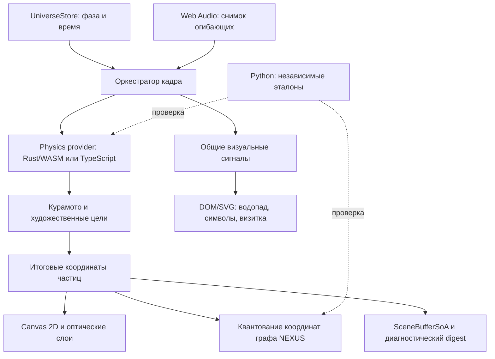

<!-- НАЗНАЧЕНИЕ: Устройство приложения, контракты данных и воспроизводимые проверки. -->
<!-- РАЗДЕЛЫ: 1. Конвейер; 2. Модули; 3. Память; 4. Время; 5. Представление; 6. Проверки. -->
# Архитектура UNIVERSE

UNIVERSE — статическое приложение Astro с общим состоянием сцены и управляемым циклом отрисовки. Один художественный мир представлен космической оптикой ILLUSION, топологией NEXUS и инженерным слоем X-RAY.

## 1. Конвейер кадра



Provider исполняется до художественных целей. Canvas читает итоговые particle-объекты, граф — квантование тех же координат, SoA — их публикацию. Объекты частиц, JS-массивы и линейная память WASM имеют разные представления; это не один общий непрерывный блок памяти.

## 2. Ответственность модулей

| Подсистема | Основные исходники | Роль |
|---|---|---|
| Оболочка | `frontend/src/pages/index.astro` | Холст, элементы управления и точки монтирования |
| Состояние | `store/universeState.ts`, `store/stressState.ts` | Фазы, пауза, оптическая линза и взаимодействия |
| Рендеринг | `engine/renderer.ts`, `engine/pipeline.ts` | Оркестрация кадра и High-DPI Canvas 2D |
| Хореография | `phases/01_void.ts`–`05_singularity.ts` | Целевые формы частиц и переходы |
| Физика | `bridge/wasmBridge.ts`, `physics_engine/src/` | Общая модель TS/Rust и непрерывный fallback |
| NEXUS | `bridge/simulationWorker.ts`, `backend/core/graph_logic.py` | Синхронный TS-граф и независимый Python reference |
| Представление | `layers/Layer2_Metrics.tsx`–`Layer5_CipherFinale.tsx` | Монтируемые один раз DOM/SVG-панели |
| Декоративные сигналы | `core/visualSignals.ts`, `core/glyphGrammar.ts`, `core/glyphHover.ts` | Общий кадр, словарь и отклик символов |
| Движение интерфейса | `core/buttonMotion.ts` | Повороты цельных плашек и кнопок, глубина, свет, тени и выравнивание |
| Композиция финала | `core/finaleComposition.ts` | Общая геометрия яркого кольца и безопасного размещения визитки |
| Шрифты символов | `core/glyphFontAssets.json`, `assets/fonts/`, `frontend/public/fonts/LICENSE.txt` | Локальные наборы Noto как Vite-ресурсы, покрытие Unicode, хеши и лицензии OFL |
| Аудио | `utils/audioSync.ts` | Воспроизведение и сглаженные музыкальные параметры |
| Диагностика | `core/integrationRegistry.ts`, `core/resourceLedger.ts` | Статусы исполнителей и учёт ресурсов |

Rust/WASM загружается асинхронно. Успешный native-шаг даёт статус `WASM_ACTIVE`; `?wasm=0`, ошибка загрузки, несовместимый ABI или trap выбирают TypeScript. Python работает как локальный инструмент и эталон в проверках. NEXUS исполняется синхронно в TypeScript. WebGPU проверяется на поддержку; WGSL-файлы являются спецификациями, а Canvas 2D остаётся активным рендерером.

## 3. Память и численные контракты

`SceneBufferSoA` хранит 24-байтный little-endian заголовок `UNVS` версии 2 и отдельные типизированные массивы `id`, `kind`, `pos`, `vel`, `depthZ`, `energy`, `flags`. Запись проверяет конечность восьми числовых полей сущности. Выборочный FNV-1a digest помогает диагностировать состояние; совпадение хеша не доказывает равенства полной геометрии или экранных преобразований.

Raw Rust ABI v1 не требует imports или JS glue. Шаг, накопленное время и метрики передаются как `f64`, массивы — как `f32`. Положительный шаг ограничен `0.05 с` и разбивается на равные подшаги не более `0.004 с`. `step_verlet_nbody` возвращает статус `1`/`0`; host проверяет его до чтения результатов.

Оба provider рассчитывают фазы Курамото активных частиц и отдельный контрольный ансамбль `REF64`: 64 орбиты в статическом потенциале Пламмера. Фазы влияют на дыхание и поздний GENESIS. Энергетическая телеметрия описывает только контрольные орбиты. Художественная сцена не является полной N-body симуляцией.

При поздней загрузке WASM принимает актуальные TS-массивы, начальную энергию и накопленное время. После принятого native-шага обновляются TS-зеркала; при отказе расчёт продолжается от последнего целого состояния. Отклонённый upload требует отказаться от provider, поскольку его live-массивы не обеспечивают rollback.

`evaluate_lens_refraction(px, py, lensX, lensY, radius, reveal)` возвращает скалярную длину смещения при фиксированных `stress=0.25`, `time=0`. Проверки сравнивают этот reference с длиной нормализованного TS-вектора. Полная векторная оптика Canvas рассчитывается в TypeScript.

Для публикации графа TS/Python применяется `floor(value * scale + 0.5) / scale`, включая отрицательные ties к `+∞`. Кривые Безье используют таблицу накопленной длины по четырём хордам; обратная интерполяция уменьшает неравномерность движения. BFS использует шаг стартовых вершин `max(1, floor(Nactive / 28))`, а не жёсткий предел в 28 стартов.

## 4. Время и жизненный цикл

Таймлайн пяти фаз, накопленное физическое время и позиция аудио имеют отдельные роли. Музыка не служит неявными часами физического provider и не перезапускается вместе с визуальным циклом.

Renderer публикует неизменяемый `VisualSignalSnapshot`. Нормализованный `frameDtSec` ограничен диапазоном `0..0.05 с` и равен нулю при паузе или скрытой вкладке. Декоративные потребители накапливают этот шаг независимо от скачков абсолютного времени при смене фазы.

Водопад кеширует DOM-привязки после монтирования каскада; визитка, символы и водопад используют общие кадры. Скрытая или остановленная анимация не выполняет холостую работу с геометрией. Отписки и обработчики освобождаются при снятии соответствующего слоя. `QualityGovernor` хранит окно времени кадра и управляет профилем качества с гистерезисом; его p95 — текущая телеметрия, не результат бенчмарка.

## 5. Представление и доступность

Декоративный перебор статических строк и действий визитки сохраняет точный канонический текст и доступное имя элемента. Для generic `p/span` канон находится в отдельном доступном span, а декоративное представление помечено `aria-hidden`. Кнопки, ссылки и заголовки сохраняют стабильные доступные названия. Центральная квантовая строка из 25 ячеек и символы водопада имеют собственные представления.

Глифы перечисляются полными Unicode code point. Локальные наборы Noto из `src/assets/fonts/` содержат выбранные знаки, а `glyphFontAssets.json` задаёт файлы с хешами, диапазоны Unicode и источники лицензий. CSS и preload используют одни и те же URL сборки Vite; исходные лицензии публикуются в `fonts/LICENSE.txt`. Кешируемый фильтр проверяет начертания; системный font stack и базовый ASCII-пул служат fallback. Исторические знаки используются как художественные символы без вымышленного перевода.

Три угловых меню используют цельные плашки с неизменными надписями. `buttonMotion.ts` задаёт индивидуальные повороты X/Y/Z и глубину на общем кадровом сигнале; фаза, её прогресс, Курамото, stress и музыка мягко влияют на ориентацию. CSS формирует фаски, подложку и толщину нижних кнопок, а блики и тени следуют повороту. Наведение или фокус плавно возвращает выбранный элемент в прямое положение и удерживает его; движение остальных продолжается. Строки верхнего информационного блока сохраняют семантику текста и заголовков. Контроллер освобождает привязки и не создаёт отдельный цикл RAF.

Визитка сначала раскрывается в центре финальной сцены. В следующих циклах она плавно занимает верхнюю свободную область с зазором над светлой областью фотонного ореола. `finaleComposition.ts` задаёт общую геометрию ореола и размещения карточки в CSS-пикселях, включая огибающую её дыхания; DPR применяется в Canvas pipeline. `bindHudDockLayout()` измеряет верхнее меню и нижний док через `ResizeObserver` и передаёт безопасные отступы в `--hud-top-inset` и `--hud-bottom-inset`, чтобы карточка учитывала перенос увеличенных кнопок. Пауза сохраняет положение; reduced motion использует статичное представление. На низких экранах ограничение подъёма сохраняет доступность текста и действий; полный зазор над ореолом зависит от свободного места.

## 6. Воспроизводимые проверки

Из корня репозитория:

```sh
npm ci
rustup target add wasm32-unknown-unknown
npm run verify:all
```

Нужны Node.js `>=22.23.4`, Python `3.11+` и Rust. Зависимости устанавливаются по lock-файлу. Общая команда выполняет проверку полноты исходников, Python verifier/unittest, native Rust, TypeScript, сборку и интеграции реального WASM, Astro и проверку Pages-артефакта.

Отдельные команды: `npm run typecheck`, `npm test`, `npm run test:python`, `npm run test:rust`, `npm run build:wasm`, `npm run verify:wasm`, `npm run build`, `npm run verify:pages-artifact`.

Численные проверки охватывают PRNG, бинарный протокол, NEXUS, шаг времени, перенос состояния и fallback, оптический reference и связь native-фаз с публикуемой геометрией. Общие fixtures описывают конкретные входы; они не являются доказательством эквивалентности всех возможных графов. DOM-регрессии проверяют доступность, восстановление текста и жизненный цикл анимации.

Визуальная приёмка включает последовательность фаз, повтор цикла, размер viewport, управление с клавиатуры и указателя, паузу/reduced motion, загрузку/отказ WASM и политику автозапуска звука. Производительность сравнивается на одинаковом устройстве, seed и профиле после прогрева.

[Технический справочник](../UNIVERSE_BIBLE.md) · [Решение о вычислительных модулях](ADR-001-POLYGLOT-RUNTIME.md) · [Математические модели](study_materials/MATHEMATICAL_AND_ASTROPHYSICAL_MODELS.md)
